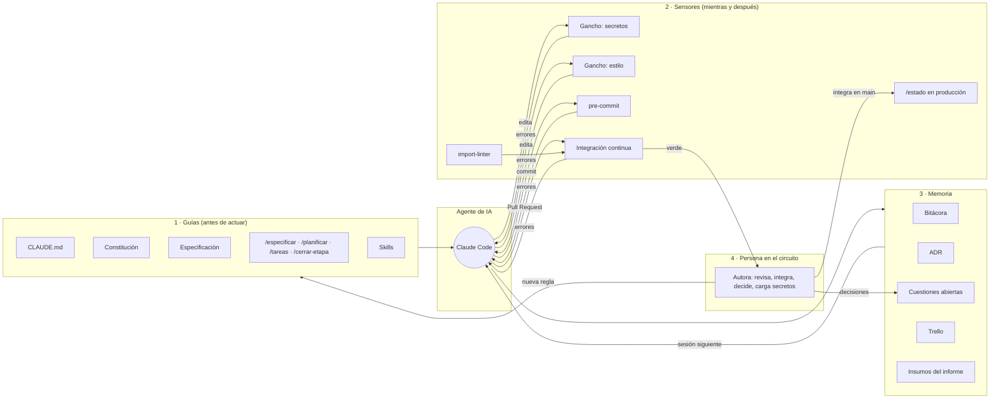

# Arnés para el trabajo asistido por IA

Este documento describe el **arnés** (*harness*) del proyecto: todo lo que rodea al agente de IA (Claude Code) para que trabaje de forma confiable, trazable y dentro de las reglas del proyecto. El agente escribe la mayor parte del código; el arnés define qué sabe, cómo trabaja, qué lo frena, qué recuerda y qué decide una persona.

> **Idea central:** la calidad no se le pide al modelo; se la construye alrededor. Lo que no está escrito, el agente no lo sabe; lo que no se verifica automáticamente, tarde o temprano se rompe.

El arnés se construyó y se mejoró como parte del proyecto (funcionalidad 036, [ADR-0021](../arquitectura/decisiones/0021-arnes-para-el-trabajo-asistido-por-ia.md)). Sus cambios quedan en el [registro de cambios](registro-de-cambios.md).

## Cómo encaja

## 1. Guías: le dicen al agente cómo trabajar antes de que actúe

| Pieza | Dónde | Qué aporta |
|---|---|---|
| Reglamento del agente | `CLAUDE.md` | Reparto del trabajo, idioma, arquitectura en capas, documentar cada función con su requisito, nunca emitir veredictos, nunca tocar secretos, calidad mínima, commits y documentación al cerrar |
| Principios no negociables | `docs/constitucion.md` | Lo que no se discute en ninguna funcionalidad |
| Fuente de verdad | `docs/especificacion/` | Requisitos, reglas de negocio, casos de uso y cuestiones abiertas: sin especificación no se implementa |
| Flujo guiado por especificaciones | `.claude/commands/` | `/especificar` → `/planificar` → `/tareas` → `/cerrar-etapa`; cada funcionalidad tiene su carpeta en `docs/funcionalidades/` |
| Skills | `.claude/skills/`, `skills-lock.json` | Conocimiento instalado (diseño de interfaces, revisión de código, diagramas, crítica de ideas), con su origen y su huella |
| Guías de trabajo | `docs/guias/` | Flujo de trabajo, identidad visual, despliegue, Trello |

## 2. Sensores: avisan o frenan cuando algo está mal

Ordenados del más temprano al más tardío. Cuanto antes avisa un sensor, más barato es corregir.

| Momento | Sensor | Qué controla | Si falla |
|---|---|---|---|
| Antes de cada acción del agente | Gancho `proteger_secretos.py` (`.claude/settings.json`, `PreToolUse`) | Que no lea, edite ni suba `.env`, `terraform.tfvars`, `backend.hcl`, estado de Terraform ni claves | **Bloquea la acción** y le explica el motivo al agente |
| Después de cada archivo editado | Gancho `revisar_estilo.py` (`PostToolUse`) | flake8 en Python del backend, ESLint en JavaScript del frontend | Le devuelve los errores al agente, que los corrige en el momento |
| Antes de cada commit | `.pre-commit-config.yaml` | Formato del mensaje (commitlint), flake8, **detección de claves privadas**, archivos grandes, conflictos | El commit no se crea |
| En las pruebas | import-linter (`backend/pyproject.toml`) | 3 contratos de arquitectura: capas solo hacia abajo, rutas solo usan servicios, servicios no conocen Flask | Falla la prueba |
| En cada Pull Request | `.github/workflows/integracion-continua.yml` | pylint ≥ 8,5; pruebas con cobertura ≥ 80 %; ESLint; Vitest; compilación; Conventional Commits en español; Terraform; shellcheck; pip-audit; npm audit; Nginx | No se puede integrar |
| Al integrar en `main` | Despliegue en el mismo flujo | Solo despliega si todo lo anterior pasó | No se despliega |
| En producción | Página `/estado` | API, base de datos, cola y sello en Hedera | Se ve a simple vista, sin entrar al servidor |

## 3. Memoria: lo que sobrevive entre sesiones

Las sesiones con el agente se cortan, se resumen o cambian; el conocimiento queda en el repositorio.

| Pieza | Dónde | Para qué |
|---|---|---|
| Bitácora | `docs/bitacora/` | Qué se hizo, qué se decidió y qué falta, por etapa |
| ADR | `docs/arquitectura/decisiones/` | Decisiones de arquitectura con alternativas y consecuencias |
| Cuestiones abiertas | `docs/especificacion/06-cuestiones-abiertas.md` | Lo que el agente **no puede decidir**, con su propuesta provisoria y la resolución de la autora |
| Seguimiento por funcionalidad | `docs/funcionalidades/NNN-*/tareas.md` | Tareas marcadas y criterios cumplidos |
| Tablero | Trello | Estado visible para la autora y los tutores |
| Insumos del informe | `docs/informe-final/insumos.md` | Hallazgos y decisiones para el informe final |
| Traspasos entre sesiones | Mensajes entre sesiones | Cuando el trabajo se reparte entre sesiones (por ejemplo, red neuronal y sistema), cada una sabe qué le toca |

## 4. Persona en el circuito: lo que la IA no hace sola

- El agente trabaja en ramas propias. **La autora revisa, abre los Pull Requests y los integra.**
- **Las decisiones** de alcance, legales, de privacidad, de costos y de arquitectura de gran impacto son de la autora (y de los tutores).
- **Los secretos** nunca pasan por el agente. La autora los carga en AWS o en su máquina, y el gancho de secretos lo hace cumplir.
- **La trazabilidad:** cada commit del agente lleva `Co-Authored-By`.
- **Las pruebas contra servicios reales** a los que el agente no llega (producción, AWS, Hedera) las hace la autora con guías que escribe el agente.

## 5. Mejora continua del arnés

El arnés no se escribió de una vez. **Cada vez que algo falla o se repite, se agrega una regla, un comando, un gancho o un control**, y queda en el [registro de cambios](registro-de-cambios.md) con el problema que lo motivó. Eso es lo que distingue al arnés de una lista de buenas prácticas: se mide por los errores que dejan de repetirse.

## 6. El informe final también tiene arnés (funcionalidad 039)

El documento para la facultad se escribe con la misma lógica que el código: guías antes de escribir, sensores que detectan errores y memoria del estado. Detalle en [docs/informe-final/README.md](../informe-final/README.md).

| Pieza | Tipo | Qué hace |
|---|---|---|
| `guia-de-redaccion.md`, `hechos-del-sistema.md`, `trabajo-con-ia.md`, `plan-de-negocios.md` | Guías | Estructura del protocolo, reglas de redacción y de evidencia, datos verificados y textos base |
| `/redactar-informe`, `/revisar-informe`, `/generar-diagramas` | Guías (comandos) | Escribir una sección, revisar como un evaluador de tesis, generar y revisar los diagramas |
| `revisar_informe.py` | Sensor | Secciones vacías, duplicados, numeración, citas y bibliografía, viñetas, tiempo verbal, marcadores, veredictos |
| `cifras_del_proyecto.py` | Sensor | Las cifras del proceso salen del repositorio, nunca de memoria |
| `diagramas_del_sistema.py verificar` | Sensor | Diagramas generados desde el código; fidelidad contra la infraestructura; notación UML; ortografía; recortes |
| `estado-del-informe.md` y `revisiones/` | Memoria | Qué falta por capítulo y la última revisión con sus correcciones |

## Números del proceso (al 2026-11-02)

| Indicador | Valor |
|---|---|
| Commits (sin contar integraciones) | 282 |
| Commits con co-autoría de IA | 238 (84 %) |
| Pull Requests integrados | 67 |
| Especificaciones / planes | 30 / 29 |
| Entradas de bitácora | 48 |
| ADR | 18 |
| Pruebas automáticas | 471 backend + 253 frontend |

Las cifras actualizadas se obtienen con `python backend/herramientas/cifras_del_proyecto.py`. Al 2026-11-05: 332 commits, 301 con coautoría de IA (90,7 %), 73 pull requests, 754 pruebas, 21 ADR y 58 entradas de bitácora.

## Límites conocidos

- El agente trabaja en un contenedor en la nube: no llega a producción, a AWS ni a algunos servicios externos (Hedera, Cresium). Esas verificaciones dependen de la autora.
- Los ganchos de estilo dependen de que la herramienta esté instalada en la máquina; si no está, no hacen nada y el control definitivo sigue siendo la integración continua.
- El gancho de secretos reconoce los archivos por su nombre: no detecta un secreto copiado dentro de otro archivo (para eso están `detect-private-key` y la revisión del Pull Request).
