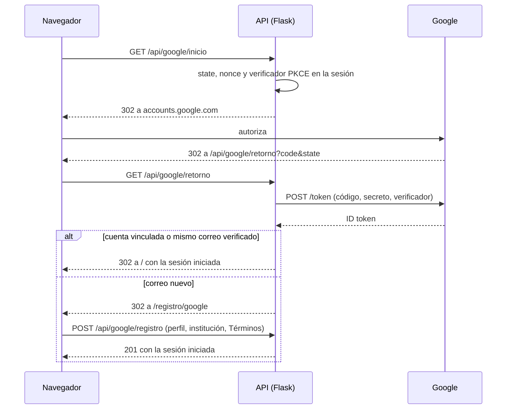

# Plan técnico: 027 — Inicio de sesión y registro con Google

## Enfoque

OpenID Connect con el **flujo de código de autorización y PKCE, del lado del servidor** (ADR-0019). El backend no guarda *tokens* de Google: solo el identificador estable de la cuenta (`sub`).

## Componentes

| Capa | Archivo | Responsabilidad |
|---|---|---|
| Integración | `app/integraciones/google.py` | Arma la dirección de Google, canjea el código y valida el *ID token* (emisor, audiencia, vencimiento, `nonce`) |
| Servicio | `app/servicios/servicio_google.py` | `state` y PKCE; decide entre iniciar sesión, vincular o pedir el registro; vigencia del registro pendiente |
| Servicio | `servicio_cuentas.py` | `registrar_con_google` y `vincular_google` |
| Servicio | `servicio_sesion.py` | `autenticar_con_google` (RN39 y Administrador) y `registrar_rechazo_google` |
| Repositorio | `repositorio_usuarios.py` | `obtener_por_google` |
| Modelo | `usuario.py` | `google_sub` (único, opcional); migración `d1a7b3c5e027` |
| Rutas | `app/rutas/google.py` | `estado`, `inicio`, `retorno` y `registro` (GET y POST) |
| Frontend | `BotonGoogle.jsx`, `PaginaRegistroGoogle.jsx`, `api/google.js` | Botón, avisos del inicio de sesión y pasos para completar el registro |
| Frontend | `SelectorPerfil.jsx`, `PasoInstitucion.jsx`, `AceptacionTerminos.jsx` | Partes del registro, extraídas para compartirlas con el registro con Google |
| Infraestructura | `parametros.tf`, `variables.tf`, `generar_entorno.sh` | `GOOGLE_ID_CLIENTE` en Terraform; el secreto se carga a mano en SSM |

## Decisiones

- **Sin biblioteca de JWT**: el *ID token* llega por TLS directo desde Google, con el secreto del cliente. OpenID Connect Core 1.0 (3.1.3.7) admite validar el emisor por TLS (ADR-0019).
- **Cookie `SameSite=Lax`** (antes `Strict`): la vuelta desde Google es una navegación desde otro sitio, y con `Strict` llegaría sin la cookie y se perdería el `state`. Las solicitudes que modifican datos siguen exigiendo el token CSRF.
- **Cuentas de Google sin contraseña propia**: se guarda el hash de una contraseña aleatoria. La persona puede definir una con "¿Olvidaste tu contraseña?".
- **Sin bloqueo por intentos con Google**: el bloqueo protege la contraseña, y con Google no se escribe ninguna.
- **El registro pendiente vive en la sesión del servidor** (Redis), no en el navegador, y vence a los 15 minutos.

## Pruebas

- `pruebas/integracion/test_google.py`: 31 pruebas con un *token endpoint* falso. Cubren el flujo completo, la vinculación, los rechazos y los errores de red.
- `src/paginas/google.test.jsx`: 10 pruebas del botón, los avisos y el registro por pasos.
