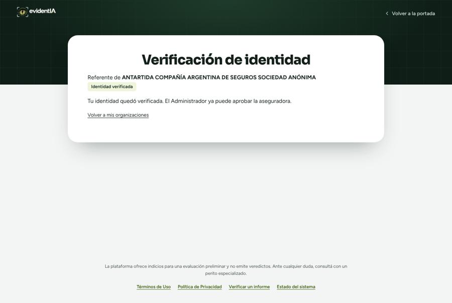
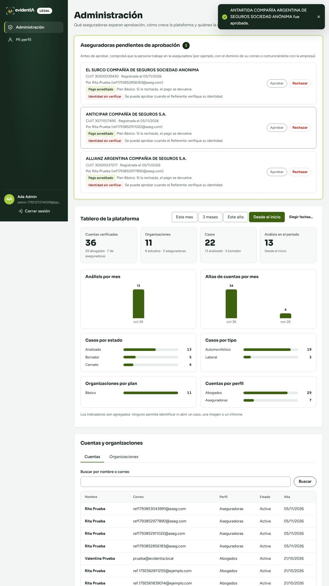
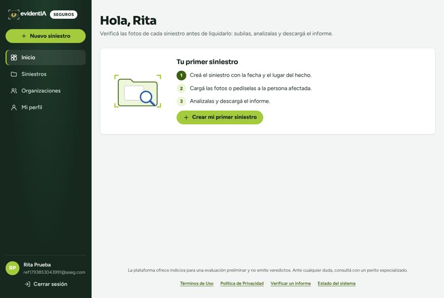
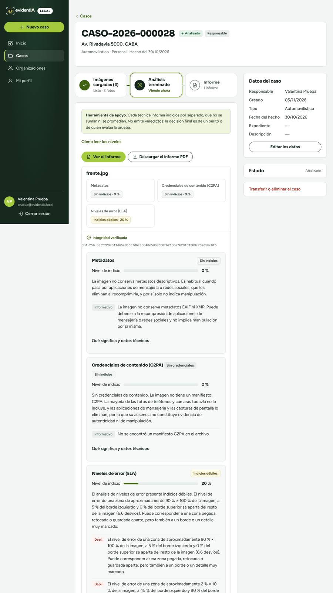
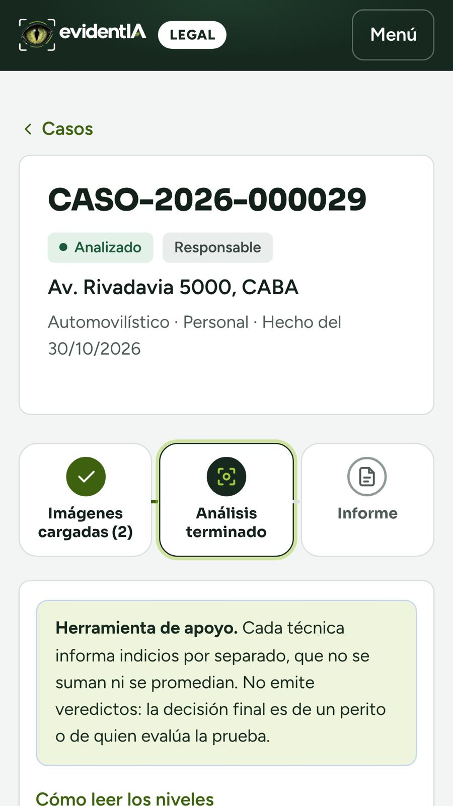
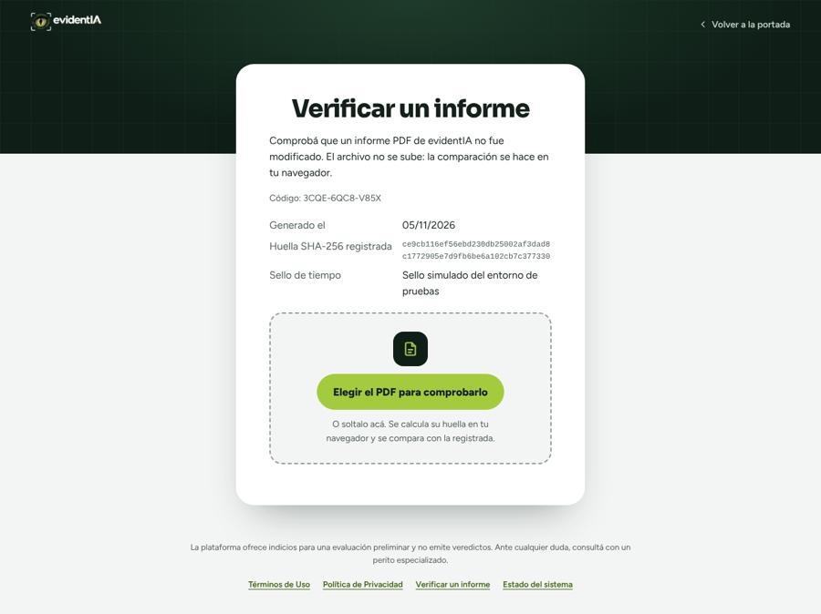
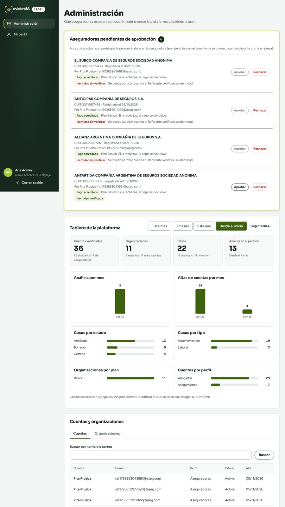
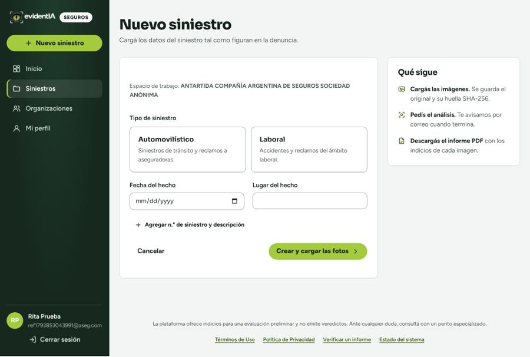

# Evidencia: recorridos de punta a punta (2026-11-05)

Corrida con los scripts de `frontend/e2e/` contra el entorno local (PostgreSQL, Redis, SMTP de prueba, Flask y Vite), en Chromium.

## Aseguradora (computadora)

| Paso | Resultado |
|---|---|
| Elegir «Aseguradora», datos y aseguradora del catálogo | Correcto |
| Plan y cuenta → «Crear la cuenta e ir al pago» | Correcto |
| Pago simulado | Acreditado |
| Correo de verificación (SMTP de prueba) | Recibido y usado |
| Ingreso con la aseguradora pendiente | «Hola, Rita»; aviso de pendiente de aprobación |
| Administrador con la identidad sin verificar | «Aprobar» deshabilitado (RN41) — **correcto** |
| Verificar mi identidad → simular aprobada | «Identidad verificada» |
| Administrador aprueba | «… fue aprobada.» |
| Menú de la aseguradora | Inicio · **Siniestros** · Organizaciones · Mi perfil |
| Alta | «**Nuevo siniestro**» |

Hallazgo durante la prueba: elegir una aseguradora que ya tiene organización da 409 (RN37, correcto); el mensaje se muestra en el paso de la cuenta.

## Abogado (computadora y celular emulado, iPhone 13)

| Paso | Computadora | Celular |
|---|---|---|
| Ingreso | Correcto | Correcto |
| Caso nuevo (automovilístico, fecha, lugar) | CASO-2026-000028 | CASO-2026-000029 |
| Subir dos fotos | 2 | 2 |
| Análisis | Terminado | Terminado |
| Informe PDF | Descargado, formato breve con «Herramienta de apoyo» arriba | Descargado |
| Verificación pública por código | Muestra código, fecha, huella y sello | — |

Errores de JavaScript en la página: ninguno. Los 401 de la consola son la consulta de sesión antes de ingresar (esperados).

## Limitaciones de esta evidencia

- Solo Chromium: en el entorno del agente no están instalados Firefox ni WebKit (Safari). **Pendiente:** probarlo en Safari (iPhone) y en Firefox; lo hace la autora con la guía de usuario.
- El sello en Hedera local es simulado; en producción ya se probó contra testnet (2026-11-02).

## Capturas

## Segunda corrida (2026-11-05, noche)

- Informe PDF real descargado por la interfaz: incluye «Más detalle y verificación» con los dos QR (análisis detallado y verificación pública); 4 páginas con dos imágenes.
- Hallazgo y corrección: en la portada, el título de la tarjeta «Aseguradoras» no se veía (texto oscuro sobre fondo oscuro).
