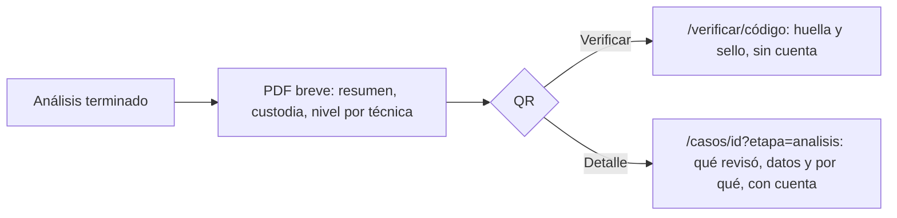

# Plan técnico: 037 — Acceso, pantallas internas e informe

## Piezas

| Pieza | Archivos | Qué hace |
|---|---|---|
| Acceso | `frontend/src/estilos/acceso.css` | Tarjetas de 34rem (login) y 56rem (registro), campos de 56 px; en el celular, a todo el ancho |
| Paleta interna | `frontend/src/estilos/global.css` (bloque «Paleta de la portada») | Redefine los tokens «azul» como verdes; menú verde bosque; acción lima; rubro en píldora blanca |
| Buscador | `componentes/BuscadorRapido.jsx`, `Encabezado.jsx` | Sin botón en la barra en computadora (Ctrl K); en el celular queda dentro del menú |
| Flujo del caso | `paginas/PaginaCaso.jsx` (`FlujoDelCaso`) | Pasos en horizontal con el contenido debajo |
| Vocabulario | `utilidades/lenguaje.js`, `hooks/useRubro.js` | «caso» para abogados, «siniestro» para aseguradoras en todas las pantallas |
| Celular | `estilos/global.css` (bloque «Ajustes del celular») | Contadores en grilla, pestañas en dos filas, informe sin márgenes anidados |
| Huella | `componentes/HuellaCorta.jsx`, `utilidades/archivos.js` | Huella abreviada con «Copiar» |
| Informe PDF | `backend/app/plantillas/informes/informe_analisis.html`, `servicio_informes.py` | Una línea de «herramienta de apoyo» arriba, escala compacta, técnica breve, enlace al análisis detallado con QR |
| Portada | `paginas/PaginaPortada.jsx`, `estilos/portada.css`, `public/portada/*.jpg` | Tarjetas por perfil, red neuronal «Próximamente», capturas nuevas |
| Legales | `PaginaPrivacidad.jsx`, `PaginaTerminos.jsx` | Google, pagos, identidad, fotos de terceros, quién trata los datos, perfiles y planes |

## Decisiones

- **Tokens en lugar de reglas sueltas**: la paleta se cambió redefiniendo `--azul*` e `--info*`; así no hubo que tocar cada componente.
- **Vocabulario sin cambiar datos**: las direcciones (`/casos`) y el número `CASO-` se mantienen (decisión 4 de la autora).
- **PDF breve + detalle en línea** (propuesta del tutor): el enlace lleva al análisis del caso en la plataforma, que exige una cuenta con acceso. Un detalle público por enlace queda como cuestión abierta (CP-43) porque expone datos del caso.

## Flujo del informe

