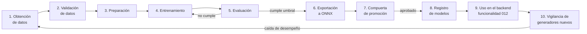
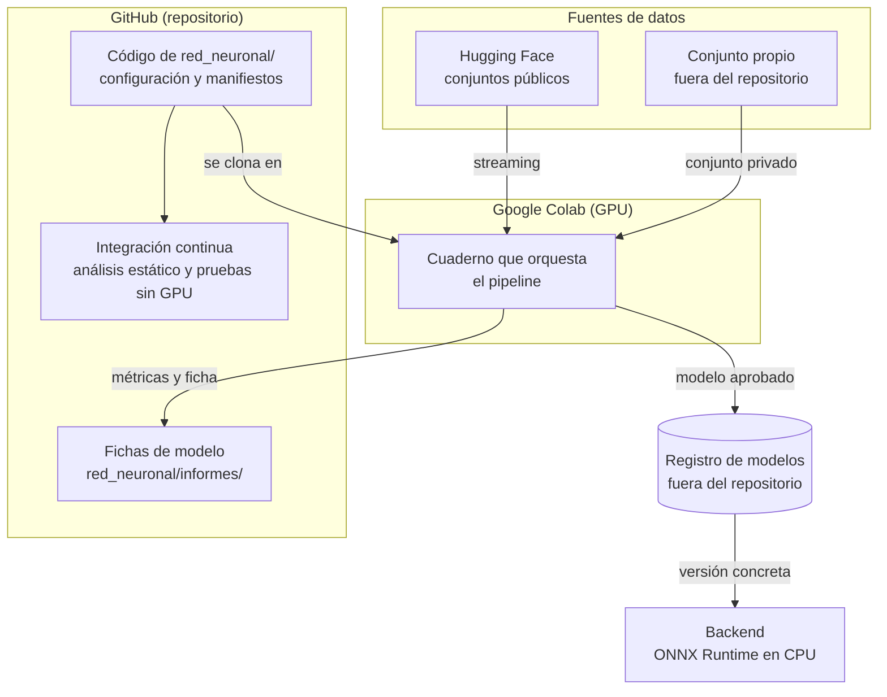

# Ciclo de vida de la red neuronal

Guía conceptual para entender cómo se construye, se publica y se mantiene el clasificador de la capa 4. Explica cada etapa del ciclo de vida, los flujos entre herramientas y las prácticas de MLOps que se aplican. La especificación de esta funcionalidad está en [docs/funcionalidades/010-red-neuronal/especificacion.md](../funcionalidades/010-red-neuronal/especificacion.md) y el diseño técnico en su [plan.md](../funcionalidades/010-red-neuronal/plan.md); las herramientas elegidas se justifican en [ADR-0014](../arquitectura/decisiones/0014-ciclo-de-vida-y-mlops-del-clasificador.md) y [ADR-0015](../arquitectura/decisiones/0015-arquitectura-y-contrato-de-inferencia-del-clasificador.md).

## 1. Por qué un modelo necesita un ciclo de vida

En el software tradicional, el comportamiento depende solo del **código**. En un modelo de aprendizaje automático, depende de tres cosas:

| Elemento | Qué es | Cómo se versiona |
|---|---|---|
| **Código** | Preparación de datos, arquitectura, entrenamiento y evaluación | Git, como el resto del sistema |
| **Datos** | Las imágenes con las que aprende y con las que se evalúa | Manifiesto con la huella de cada imagen, versionado en Git; las imágenes, fuera |
| **Modelo** | Los pesos resultantes del entrenamiento | Registro de modelos, con versión, huella y ficha |

Si cambia cualquiera de los tres, cambia el modelo. **MLOps** (operaciones de aprendizaje automático) es aplicar ingeniería de software a esos tres elementos: versionarlos, automatizar su recorrido, verificar su calidad y poder reproducir cualquier resultado. En este proyecto la reproducibilidad no es opcional: un informe pericial debe poder explicar con qué modelo se obtuvo cada resultado (RN29).

## 2. Las etapas del ciclo

| Etapa | Qué hace | Entrada | Salida |
|---|---|---|---|
| 1. Obtención | Descarga muestras balanceadas de los conjuntos públicos | Configuración de fuentes | Imágenes y manifiesto crudo |
| 2. Validación | Detecta imágenes corruptas, duplicados, solapamiento entre particiones y desbalance; si algo falla, el pipeline se detiene | Manifiesto crudo | Informe de validación |
| 3. Preparación | Normaliza formato y compresión (para evitar atajos), particiona con semilla fija | Imágenes validadas | Manifiesto versionado con particiones |
| 4. Entrenamiento | Transferencia de aprendizaje sobre una red convolucional preentrenada | Manifiesto y configuración | Pesos y registro del experimento |
| 5. Evaluación | Métricas en total, por generador, con el conjunto propio y con imágenes recomprimidas | Pesos y conjuntos de prueba | Métricas, curva ROC y matriz de confusión |
| 6. Exportación | Convierte a ONNX y comprueba que la salida coincide con la del modelo original | Pesos | Archivo `.onnx` |
| 7. Compuerta | Verifica automáticamente el umbral, la coincidencia ONNX y la ficha completa | Métricas y modelo | Aprobado o rechazado |
| 8. Registro | Publica la versión con su huella y su ficha | Modelo aprobado | Versión `MAJOR.MINOR.PATCH` |
| 9. Uso | El backend descarga una versión concreta y la ejecuta en CPU | Versión del modelo | Probabilidad + versión en el informe |
| 10. Vigilancia | Ante un generador comercial nuevo, se evalúa con el conjunto propio | Imágenes nuevas | Decisión de reentrenar |

## 3. Prueba de concepto antes del entrenamiento completo

Antes de invertir horas de GPU, se recorre todo el ciclo con un subconjunto chico (no más de 10 000 imágenes). El objetivo **no** es obtener buenas métricas, sino comprobar que:

- todas las etapas se conectan y producen sus salidas;
- el modelo ONNX corre en CPU y su salida coincide con la del modelo original;
- se pueden estimar el tiempo y la memoria del entrenamiento completo.

Si la prueba de concepto falla, se corrige el diseño con un costo bajo. Es el equivalente, en la red neuronal, al esqueleto caminante de la funcionalidad 001.

## 4. Dónde ocurre cada cosa

- **La lógica vive en módulos de Python dentro del repositorio**, probados y documentados. El cuaderno de Colab solo clona el repositorio, ejecuta las etapas y muestra resultados. Así el código se revisa, se prueba y se versiona como cualquier otro; un cuaderno con toda la lógica adentro no se puede probar ni reutilizar.
- **Los datos y los modelos nunca entran al repositorio.** Lo que se versiona en Git es lo que permite reconstruirlos: los manifiestos, la configuración y las fichas.
- **Las credenciales** (Hugging Face, GitHub) se cargan como secretos de Colab; nunca se escriben en el cuaderno.

## 5. CI, CT y CD: integración, entrenamiento y entrega continuos

En aprendizaje automático, la "integración y entrega continuas" se divide en tres prácticas:

| Práctica | Qué automatiza | Cuándo se ejecuta | En este proyecto |
|---|---|---|---|
| **CI** — Integración continua | Análisis estático y pruebas del código del pipeline con datos mínimos, sin GPU | En cada envío a GitHub que toque `red_neuronal/` | GitHub Actions, junto con el resto de la integración continua (RNF20) |
| **CT** — Entrenamiento continuo | Volver a entrenar cuando cambian los datos o el código | Manual, a pedido, cuando la vigilancia lo indica | Ejecución del cuaderno en Colab |
| **CD** — Entrega continua del modelo | Exportar, verificar la compuerta y publicar la versión | Al terminar un entrenamiento | Etapas 6 a 8 del pipeline |

### Qué prueba la integración continua sin GPU

Las pruebas no entrenan un modelo real. Verifican que **el código hace lo que debe**:

- la validación de datos detecta una imagen corrupta, un duplicado y un solapamiento entre particiones;
- la preparación produce siempre el mismo manifiesto con la misma semilla;
- un paso de entrenamiento sobre un lote de pocas imágenes reduce la pérdida;
- la exportación a ONNX produce la misma salida que el modelo original;
- las métricas coinciden con valores calculados a mano en un caso simple.

Así un error en el pipeline se detecta en minutos, en la integración continua, y no después de horas de entrenamiento.

## 6. Niveles de madurez de MLOps

Una clasificación habitual de la industria distingue tres niveles:

| Nivel | Descripción | ¿Aplica? |
|---|---|---|
| **0 — Manual** | Cuadernos ejecutados a mano, modelos copiados a mano, sin trazabilidad | Es lo que se evita |
| **1 — Pipeline automatizado** | Pipeline por etapas, datos y modelos versionados, experimentos registrados, compuerta de promoción, reentrenamiento a pedido | **Objetivo del proyecto** |
| **2 — CI/CD del pipeline completo** | Reentrenamiento disparado automáticamente por datos nuevos y monitoreo en producción | Fuera de alcance: no hay datos de producción reutilizables por confidencialidad (RNF08), y el costo de GPU propio no se justifica |

## 7. Reentrenamiento

Los generadores comerciales cambian varias veces por año, y un modelo entrenado hoy pierde eficacia frente a los de mañana. El ciclo se cierra así:

1. Cuando aparece un generador comercial nuevo o una versión nueva de uno existente, se agregan imágenes suyas al conjunto propio.
2. Se evalúa la versión vigente del modelo con esas imágenes.
3. Si el desempeño cae de forma significativa, se buscan datos públicos del generador nuevo, se actualiza el manifiesto y se reentrena.
4. La nueva versión se publica con número `MINOR` mayor. **Las versiones anteriores se conservan**, porque un informe ya emitido debe poder reproducirse con el modelo que se usó.

## 8. Glosario

| Término | Significado |
|---|---|
| Transferencia de aprendizaje | Partir de una red ya entrenada con millones de imágenes y ajustarla a la tarea propia, en lugar de entrenarla desde cero |
| Red neuronal convolucional (CNN) | Tipo de red especializada en imágenes, que aprende patrones visuales locales |
| ONNX | Formato estándar para guardar modelos; permite entrenar en PyTorch y ejecutar en el servidor sin PyTorch |
| Manifiesto | Tabla que lista cada imagen usada, con su origen, clase, partición y huella |
| Atajo (*shortcut*) | Característica irrelevante que el modelo aprende en lugar de la real, por ejemplo el formato del archivo |
| Generador no visto | Generador cuyas imágenes no se usaron en el entrenamiento; mide la capacidad de generalizar |
| Ficha del modelo (*model card*) | Documento que describe un modelo: datos, métricas, usos previstos y limitaciones |
| Compuerta de promoción | Verificación automática que decide si un modelo puede usarse en producción |
