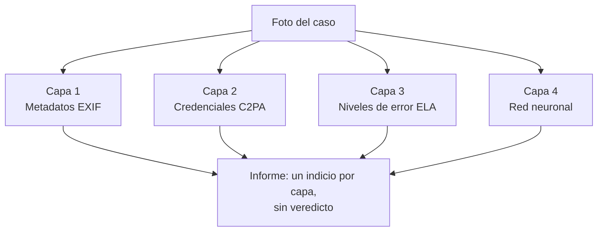

# 1. Qué es y para qué sirve

## El problema

Abogados y aseguradoras reciben fotos como prueba: el choque, la lesión en el trabajo, la máquina rota. evidentIA trabaja con dos tipos de caso: **automovilísticos** y **laborales** (accidentes de trabajo). Hoy cualquiera puede generar una foto falsa en segundos con ChatGPT, Gemini, Copilot o Midjourney. Las fotos llegan al sistema subidas por el profesional o **por la propia persona afectada, desde el enlace de carga del caso**. Puede subir la foto original, una **captura de pantalla** o una imagen hecha con IA. Una captura, o una imagen reenviada antes por una aplicación de mensajería, pierde los metadatos y las credenciales de contenido (C2PA). En ese escenario, las otras capas del análisis tienen poco para mirar y la red neuronal suele ser **el único indicio disponible**.

## Dónde está en el sistema: la capa 4

evidentIA analiza cada foto con **cuatro capas independientes**. Ninguna se combina en un puntaje único (RN27): cada una aporta su indicio y la persona decide.

| Capa | Qué mira | Tipo de indicio |
|---|---|---|
| 1. Metadatos | Datos que guarda la cámara o el programa (fecha, dispositivo, software de edición) | Determinístico: está o no está |
| 2. C2PA | Firma digital del origen, si la tiene | Determinístico |
| 3. ELA | Zonas de la foto que se recomprimieron distinto (posible retoque) | Probabilístico |
| **4. Red neuronal** | **Patrones visuales que dejan los generadores de IA** | **Probabilístico** |

## Qué hace exactamente

Recibe **una foto** y devuelve **un número entre 0 y 1**: la probabilidad estimada de que la imagen sea **íntegramente sintética**, es decir, generada de cero por una IA.

- 0,03 → muy poco probable que sea generada.
- 0,50 → el modelo no puede distinguir.
- 0,97 → muy probable que sea generada.

El número está **calibrado** (capítulo 5): si el modelo dice 0,80 en muchas fotos, alrededor del 80 % de ellas son efectivamente sintéticas. Por eso se puede mostrar como probabilidad y no como «sí» o «no».

## Qué NO hace

- **No detecta ediciones parciales.** Si alguien saca una foto real y le agrega un golpe con IA, la red puede no darse cuenta. Para eso están las capas 1 a 3.
- **No es infalible con generadores nuevos.** Un generador que no vio durante el entrenamiento puede engañarla. Por eso se mide con generadores reservados («no vistos») y se reentrena cuando aparecen generadores comerciales nuevos.
- **No emite veredictos.** El sistema nunca dice «es falsa». Dice «la capa 4 estima una probabilidad de X» y recomienda consultar a un perito.
- **No aprende de los casos de los usuarios.** Las fotos de los casos son confidenciales (RNF08) y nunca se usan para entrenar.

## Qué requisitos cumple

| Requisito | Qué pide | Dónde se resuelve |
|---|---|---|
| RF42 | Estimar la probabilidad de imagen sintética | Este modelo; se integra en el análisis en la funcionalidad 012 |
| RNF24 | Modelo reproducible, versionado, evaluado y ejecutable en CPU | Todo el pipeline (capítulos 4 a 9) |
| RN27 | Indicios, no veredictos | Calibración, leyenda en la ficha y en el informe |
| RN29 | Cada informe dice con qué versión del modelo se hizo | Registro de modelos y metadatos del ONNX (capítulo 7) |

## Funcionalidades involucradas

- **010 (esta):** construir el modelo y todo su ciclo de vida. Rama `funcionalidad/010-red-neuronal`.
- **012:** integrar el modelo en el motor de análisis y en el informe PDF.
- **017:** el despliegue en AWS, donde corre el backend que usa el modelo.
