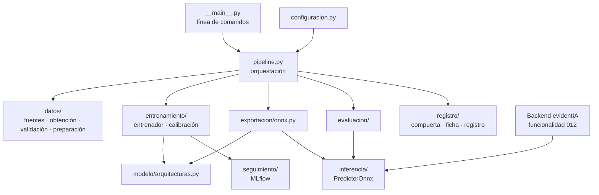

# 3. Arquitectura y organización del código

## Principio de diseño

**La lógica vive en un paquete de Python probado; los cuadernos solo orquestan** (ADR-0014). El cuaderno de Colab clona el repositorio, instala el paquete `clasificador` y llama a sus etapas por línea de comandos. Así el código se revisa, se prueba en la integración continua y se versiona en Git como el resto del sistema. Un cuaderno con toda la lógica adentro no se puede probar ni reutilizar.

## Dónde está cada cosa

```
red_neuronal/
├── pyproject.toml             Paquete, dependencias y herramientas de calidad
├── configuracion/
│   ├── prueba_de_concepto.yaml   Una configuración por ejecución (datos, hiperparámetros, umbrales)
│   ├── v1.yaml                   Receta v1 del entrenamiento completo (provisoria hasta la exploración)
│   └── candidatos_v1.yaml        Conjuntos candidatos que revisa la exploración (T25)
├── clasificador/              El paquete
│   ├── __main__.py            Línea de comandos: python -m clasificador <etapa>
│   ├── configuracion.py       Esquema validado de la configuración (pydantic)
│   ├── pipeline.py            Orquesta las 7 etapas sobre una carpeta de trabajo
│   ├── datos/
│   │   ├── fuentes.py         De dónde vienen las imágenes (Hugging Face, carpeta local)
│   │   ├── obtencion.py       Etapa obtener
│   │   ├── manifiesto.py      La tabla que identifica cada imagen y su huella
│   │   ├── validacion.py      Etapa validar: corruptas, duplicadas, fugas, balance
│   │   ├── preparacion.py     Etapa preparar: normalización anti-atajos y particiones
│   │   ├── exploracion.py     Revisa candidatos: licencia, revisión, columnas, generadores, formatos
│   │   ├── conjunto.py        Dataset de PyTorch a partir del manifiesto
│   │   └── aumentacion.py     Aumentaciones de entrenamiento
│   ├── modelo/
│   │   └── arquitecturas.py   Fábrica de redes (timm) y envoltorio exportable
│   ├── entrenamiento/
│   │   ├── entrenador.py      Bucle de entrenamiento, parada temprana, puntos de control
│   │   └── calibracion.py     Temperatura y ECE
│   ├── evaluacion/
│   │   ├── metricas.py        AUC, exactitud, precisión, F1, ECE, por grupo
│   │   └── evaluador.py       Etapa evaluar: métricas, predicciones y gráficos
│   ├── exportacion/
│   │   └── onnx.py            Etapa exportar: ONNX, coincidencia y latencia
│   ├── inferencia/
│   │   ├── preprocesamiento.py   Contrato de entrada (cinco recortes, normalización)
│   │   └── predictor.py       PredictorOnnx: lo que usa el backend
│   ├── registro/
│   │   ├── compuerta.py       Criterios para publicar
│   │   ├── ficha.py           Ficha del modelo (model card)
│   │   └── registro_modelos.py   Registro de versiones (local o Hugging Face)
│   ├── seguimiento/
│   │   └── experimentos.py    Registro de experimentos con MLflow
│   └── plantillas/
│       └── ficha_modelo.md.j2   Plantilla de la ficha
├── cuadernos/
│   ├── 00_prueba_de_concepto.ipynb         Versión para Kaggle
│   ├── 01_prueba_de_concepto_colab.ipynb   Prueba de concepto en Colab (hecha)
│   ├── 02_exploracion_datos_colab.ipynb    Exploración de candidatos y propuesta de receta (T25, T27)
│   └── 03_entrenamiento_completo_colab.ipynb   Entrenamiento completo que saltea lo ya hecho (T28 a T33)
├── pruebas/                   203 pruebas automáticas (sin GPU ni descargas)
├── informes/                  Fichas de cada versión publicada (en Git)
├── datos/                     Vacía en Git: las imágenes nunca se suben
└── modelos/                   Vacía en Git: los modelos nunca se suben
```

## Los módulos y cómo se conectan



El paquete `inferencia` es especial: **solo depende de numpy, Pillow y onnxruntime**. Es lo único que instala el backend. Así el servidor no carga PyTorch, que pesa varios GB.

## Dependencias por grupo

| Grupo | Bibliotecas | Quién lo instala |
|---|---|---|
| Base (inferencia) | numpy, Pillow, onnxruntime | El backend |
| `[entrenamiento]` | torch, torchvision, timm, onnx, onnxscript, scikit-learn, datasets, huggingface_hub, mlflow, pydantic, PyYAML, pandas, matplotlib, Jinja2 | Colab y la integración continua |
| `[desarrollo]` | pytest, pytest-cov, flake8, pylint | Quien desarrolla y la integración continua |

## Patrones de diseño

| Patrón | Dónde | Por qué |
|---|---|---|
| **Pipeline** | `pipeline.py`, una función por etapa | Cada etapa lee lo que dejó la anterior en disco y escribe lo suyo. Se puede repetir o retomar una etapa sin rehacer las demás |
| **Strategy** | `FuenteDatos`, `InspectorConjuntos`, `RegistradorExperimentos`, `RegistroModelos` | Los servicios externos (Hugging Face, MLflow) se cambian por simulaciones en las pruebas o por otro proveedor sin tocar las etapas |
| **Factory** | `crear_modelo`, `crear_fuente`, `crear_registro` | La configuración elige la implementación por nombre: cambiar de red o de fuente es cambiar una palabra en el YAML |
| **Configuración externa validada** | `configuracion.py` + YAML | Los hiperparámetros no están en el código. Un error (un campo mal escrito, proporciones que no suman 1) falla al inicio, no después de una hora de GPU |
| **Envoltorio** | `ModeloExportable` | Agrega la temperatura y la sigmoide al modelo sin modificarlo, para que el ONNX devuelva directamente una probabilidad |

## La configuración

Cada ejecución se describe con un archivo YAML en `red_neuronal/configuracion/`. La prueba de concepto usa `prueba_de_concepto.yaml`:

```yaml
nombre: prueba_de_concepto
semilla: 42
datos:
  fuentes:
    - nombre: community_forensics
      tipo: hugging_face
      conjunto: OwensLab/CommunityForensics-Small
      cantidad_reales: 5000
      cantidad_sinteticas: 5000
      excluir: { nsfw_flag: ["True"] }   # contenido explícito: no se usa
  generadores_reservados: []
  proporciones: { entrenamiento: 0.8, validacion: 0.1, prueba: 0.1 }
  calidad_jpeg: [75, 95]
  lado_menor: [256, 512]
entrenamiento:
  arquitectura: efficientnet_b0
  epocas: 3
  tamanio_lote: 64
  tasa_aprendizaje: 0.0003
  paciencia: 2
  precision_mixta: true
exportacion: { opset: 18, tolerancia: 0.001 }
compuerta: { auc_minimo: 0.90 }
```

Campos de una fuente de Hugging Face que se agregaron para la receta v1 (2026-10-30):

| Campo | Para qué |
|---|---|
| `revision` | Commit exacto del conjunto: la licencia puede cambiar entre revisiones |
| `archivos` | Muestreo **por archivos**: solo se leen los Parquet elegidos por la exploración con la semilla |
| `generadores_incluidos` | Solo se toman sintéticas de estos generadores |
| `cuota_por_generador` | Máximo de sintéticas por generador, para que ninguno domine |
| `clase_fija` | Conjuntos de una sola clase (por ejemplo, solo fotos reales de autos) |

El esquema (`configuracion.py`) **rechaza campos desconocidos**: si se escribe `epoca` en lugar de `epocas`, falla con un mensaje en español en vez de usar el valor por defecto sin avisar.

## La línea de comandos

```bash
python -m clasificador obtener  --configuracion configuracion/prueba_de_concepto.yaml
python -m clasificador validar  --configuracion ...
python -m clasificador preparar --configuracion ...
python -m clasificador entrenar --configuracion ...
python -m clasificador exportar --configuracion ... --version 0.1.0
python -m clasificador evaluar  --configuracion ... [--conjunto-propio /ruta]
python -m clasificador publicar --configuracion ... --version 0.1.0 --registro local:/ruta
python -m clasificador estado   --configuracion ...      # qué etapas ya están terminadas
python -m clasificador explorar --candidatos configuracion/candidatos_v1.yaml --salida /ruta
```

- **`estado`** responde, para cada etapa, si ya está terminada **con el manifiesto actual** (misma huella). El cuaderno de entrenamiento completo lo usa para saltear lo ya hecho después de un corte.
- **`explorar`** no necesita PyTorch: revisa los conjuntos candidatos en Hugging Face sin bajarlos enteros (capítulo 4).

Devuelve 0 si la etapa terminó bien y 1 ante un error esperable (configuración, datos, compuerta), siempre con el motivo en español. Toda la interfaz, incluida la ayuda, está en español.
