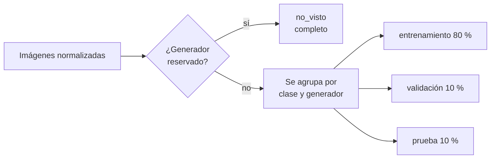

# 4. Los datos

Un modelo es tan bueno como sus datos. Este capítulo explica de dónde salen las imágenes, cómo se controlan y cómo se preparan para que el modelo aprenda lo correcto.

## De dónde sale la información

### Conjuntos públicos (para entrenar)

Se descargan de **Hugging Face**, una plataforma pública de conjuntos de datos y modelos. Se leen en *streaming*: se recorren sin bajar el conjunto entero y se toma una muestra balanceada.

| Conjunto | Qué tiene | Estado |
|---|---|---|
| **Community Forensics (*Small*)** | Fotos reales y generadas por **cientos de generadores** (Stable Diffusion y sus ajustes finos, GAN, DeepFloyd, GLIDE, etc.) | En uso desde la prueba de concepto |
| OpenFake | Imágenes de generadores comerciales recientes | En la receta v1 (`configuracion/v1.yaml`), con la familia de Google como no vista |
| MS COCOAI | Fotos de COCO y sus versiones generadas | Previsto para la receta v1 |
| ShareGPT-4o-Image | Imágenes generadas con GPT-4o | Previsto para la receta v1 si se verifica la licencia |

**Búsqueda continua de datos (2026-10-30).** La autora decidió seguir buscando conjuntos y generando imágenes para mejorar la red. La investigación con todos los candidatos (OpenFake, Treasure, AIGenImages2026, TrueFake, Semi-Truths y otros), sus licencias y su uso propuesto está en [docs/investigacion/2026-10-30-conjuntos-de-datos-imagenes-sinteticas.md](../investigacion/2026-10-30-conjuntos-de-datos-imagenes-sinteticas.md). Conclusiones clave:
- casi todas las licencias son no comerciales y cambian entre revisiones, así que la receta fija una revisión concreta de cada conjunto;
- no hay conjuntos públicos con fotos generadas por las herramientas comerciales de hoy en las escenas del sistema (choques, lesiones, accidentes de trabajo) y en versión original y captura: por eso el conjunto propio es un aporte original;
- el sesgo de formato documentado en GenImage («Fake or JPEG?») confirma la necesidad de la normalización anti-atajos.

La **licencia** de cada conjunto se verifica y se registra en la ficha (CA2). Un conjunto sin licencia verificable se excluye. Casi todos son **solo para investigación**: alcanza para el proyecto final, pero una versión comercial requeriría reentrenar con datos de licencia compatible.

Las columnas de Community Forensics se confirmaron con su esquema: `image_data` (bytes de la imagen), `label` (1 = sintética), `model_name` (generador), `nsfw_flag` (contenido explícito, que se descarta), `subset`, `real_source` y `architecture`.

### Exploración de candidatos (T25)

Antes de usar un conjunto se lo explora con `python -m clasificador explorar` (cuaderno `02_exploracion_datos_colab.ipynb`). Para cada candidato de `configuracion/candidatos_v1.yaml`:

1. pide a Hugging Face la **revisión exacta** y la **licencia de la ficha** en esa revisión. Si la licencia falta o es «other», el conjunto queda **excluido** y anotado, salvo que se haya verificado a mano en el artículo (campo `licencia_verificada_a_mano`) (CA2);
2. lee el **esquema** y confirma las columnas que espera la receta;
3. lee solo las **columnas livianas** (clase y generador) de una muestra de archivos al azar, sin bajar imágenes, y cuenta por clase y por generador;
4. baja **un solo grupo de filas** de algunos archivos y mide formato, tamaño y **calidad JPEG** (estimada con la tabla de cuantización) de cada clase, para ver si hay sesgo de formato. Antes mira en los metadatos cuánto pesa ese bloque: si pasa de 256 MB, omite la muestra de ese archivo y lo anota como aviso (pyarrow baja el bloque entero aunque se pidan pocas filas, y la primera corrida agotó la memoria de Colab);
5. deja `exploracion.json` y una tabla `exploracion.md` con la decisión de cada candidato. Los guarda después de **cada** candidato, y el cuaderno corre cada uno en su propio proceso (`--solo <nombre>`): si uno se corta, los demás siguen;
6. propone el bloque de la receta: revisión fija, archivos, generadores con más imágenes y cuota por generador.

### Resultado de la exploración (2026-11-04)

La autora corrió el cuaderno 02 en Colab (25 minutos, en CPU). Resultados guardados en `MyDrive/evidentia/exploracion/`:

| Conjunto | Revisión | Licencia | Qué tiene (12 archivos explorados) | Decisión |
|---|---|---|---|---|
| Community Forensics *Small* | `6c539a5` | CC BY-NC-SA 4.0 | 17 952 reales y 17 954 sintéticas de **216 generadores**: 6 grandes (GigaGAN 2 992, VQDiffusion 2 072, LFM 1 645, StyleGAN-XL 1 347, StyleGAN2 761, ProjectedGAN 159) y unos 210 ajustes finos de Stable Diffusion con ~46 cada uno. **Cada archivo tiene una sola clase y un único bloque de 0,3 a 4,1 GB.** Reales: JPEG de 640 px con calidad 75 | Entrenamiento |
| OpenFake | `3247b94` | CC BY-NC 4.0 | 24 063 reales y 23 817 sintéticas de **74 generadores**, comerciales incluidos: GPT Image 1 (873), DALL·E 3 (666), Midjourney 6 (1 045), Ideogram 3 (550), FLUX 1.1 Pro (620), Imagen 4 (280), Grok, Seedream, Nano Banana 2 (36). Cada archivo mezcla las dos clases | Entrenamiento y no vistos |
| Treasure | `99a2cc5` | CC BY-NC 4.0, con condiciones | ~100 000 PNG sueltos, sin Parquet | Fuera de la v1 |
| MLLM-Generated | `651a325` | **Apache 2.0** | ~45 000 imágenes sueltas (GPT Image 2, Nano Banana 2) | Fuera de la v1; candidato a no vistos de la 1.1.0 (habría que leer carpetas de imágenes) |
| ShareGPT-4o-Image | `f9bcb94` | Apache 2.0 | 20 archivos `.tar` | Fuera de la v1 |
| Semi-Truths | `6c95f94` | «cc» sin variante | Archivos `.bz2` | Excluido: licencia no verificable (CA2) |
| CarDD | `56900bd` | Investigación no comercial (verificada a mano) | 2 816 JPG sueltos | Para el conjunto propio (se copia una muestra), no para entrenar |
| ConstructionSite (MOCS) | `ca3d9b8` | CC BY-NC 4.0, con condiciones | 3 Parquet | Acceso pendiente de aprobación (error 403) |

**Sesgos de formato confirmados** (para el informe): en OpenFake las reales son JPEG de calidad 95 y muy grandes (lado menor mediano **3 349 px**, hasta 8 192), mientras que las sintéticas son PNG, JPEG y WebP de unos **880 px**. En Community Forensics las sintéticas son PNG de 512 × 512 y las reales JPEG de 640 px. Sin la normalización anti-atajos, el modelo podría separar las clases solo por el tamaño o el formato.

### La receta v1 (T27)

`configuracion/v1.yaml`, completada con la exploración:

| Fuente | Archivos | Reales | Sintéticas | Cuota por generador | Búfer de mezcla |
|---|---|---|---|---|---|
| Community Forensics | 4 de reales y 6 de sintéticas (se evita el de 4,1 GB) | 7 500 | 7 500 (de ~9 100 disponibles sin los que no son fotos) | 500 | 1 000 |
| OpenFake | Los 12 explorados | 10 000 | 10 000 (de ~16 400 disponibles) | 700 | 300 |

| Decisión | Por qué |
|---|---|
| **Generadores no vistos: la familia de Google** (Imagen 4, Imagen 3 y Nano Banana 2, que es lo que usa Gemini) | Es una herramienta comercial que usaría quien falsifica una prueba. Queda fuera del entrenamiento para medir cuánto le cuesta al modelo y es la base de la demostración de reentrenamiento (1.1.0). Son ~170 imágenes; el desbalance que dejan en el entrenamiento (~0,5 %) está dentro de la tolerancia |
| Cuotas por generador | Que GigaGAN o SD 3.5 no dominen el entrenamiento |
| Búfer de mezcla chico en OpenFake | Al leer, la mezcla guarda filas en memoria: 10 000 fotos de 4 MB agotarían la RAM. Campo nuevo `bufer_mezcla` |
| Las imágenes crudas se borran después de preparar | Las reales de OpenFake ocupan decenas de GB sin normalizar; lo preparado queda respaldado en Drive |
| Fotos reales de escenas del sistema **fuera** del entrenamiento | CarDD, SCIN y obras van al conjunto propio. En el entrenamiento no hay sintéticas de autos dañados ni de lesiones: el modelo aprendería «auto dañado = real» |

### Depuración de los datos

No se usan los conjuntos completos: se toma una muestra y se depura en cada etapa.

| Paso | Qué se descarta o se controla | Dónde |
|---|---|---|
| Selección | Solo los archivos explorados (10 de 186 en Community Forensics, 12 de 643 en OpenFake), con su revisión fija | Receta |
| Contenido explícito | Las filas marcadas `nsfw_flag` en Community Forensics | Receta (`excluir`) |
| **Generadores que no hacen fotos** (agregado el 2026-11-04) | 56 de Community Forensics (anime, historieta, pixel art, 3D caricaturesco, logos, maquetas web, fractales, patrones) y 10 de OpenFake (anime, estilo Ghibli y un modelo de prueba que genera ruido), elegidos por su nombre. Las reales son fotos: con ilustraciones del lado sintético, el modelo aprendería «ilustración = IA» | Receta (`excluir`) |
| Dominio de un generador | Cuota máxima por generador | Receta |
| **Imágenes chicas** (agregado el 2026-11-04) | Las de menos de 256 px de lado menor se descartan al obtener (`lado_menor_minimo`), y la normalización **nunca agranda**: la interpolación deja marcas propias que serían un atajo | Obtener y preparar |
| Duplicados exactos | Misma huella SHA-256 dentro de cada fuente; la validación revisa todo el conjunto | Obtener y validar |
| Corruptas, fugas y desbalance | La validación detiene el pipeline | Validar y preparar |
| Formato y tamaño | Todo a JPEG con calidad y lado menor al azar, igual para las dos clases | Preparar |

**Lo que no se depura (limitaciones para el informe):** casi duplicados (la misma foto recortada o recomprimida), reales de OpenFake que no son fotos (capturas o ilustraciones que circulan en internet) y la diferencia de temas entre las reales y las sintéticas de cada conjunto. Se mitigan en parte con la evaluación por generador y en condiciones reales.

Total: **17 500 reales y 17 500 sintéticas**, unas 3,5 veces la prueba de concepto. 15 épocas con paciencia 3.

### Conjunto propio (evaluación fija y ajuste)

Lo arma la autora siguiendo el [protocolo del conjunto propio](../guias/protocolo-conjunto-propio.md) (tarea T26): fotos generadas con **ChatGPT, Gemini, Copilot** (y Midjourney si hay acceso), **fotos reales propias** y **fotos reales editadas con IA**, de escenas de los dos tipos de caso del sistema: **automovilístico** (choques, rayones, vidrios rotos, lugar del siniestro) y **laboral** (lesiones, lugar del accidente de trabajo, herramientas y elementos de protección dañados). Cada una en dos versiones: **original y captura de pantalla**. La versión de WhatsApp se quitó el 2026-10-30 (decisión de la autora): las fotos de un caso las sube la persona afectada desde el enlace de carga, así que llegan como original, como captura o generadas con IA.

- **Regla de oro (criterio de la autora, 2026-10-30):** las fotos reales son **de las mismas escenas** que las generadas. Si no, el modelo podría distinguir el tema en lugar de la generación. Las fotos reales salen de CarDD (autos dañados), de fotos propias de la autora como complemento y de conjuntos de lesiones y de seguridad en obras que se sigan verificando.
- **Diversidad:** las lesiones se generan en seis tonos de piel para medir si el modelo funciona igual para todas las personas.
- Herramientas gratuitas: ChatGPT, Gemini (suscripción), Copilot, Meta AI, Grok y otras.
- **Cómo se genera:** la [guía paso a paso](../guias/guia-paso-a-paso-conjunto-propio.md) tiene una **lista maestra de 90 prompts numerados** (el mismo prompt en todas las herramientas, para comparar con el mismo contenido), versiones v1, v2 (suave, si la herramienta se niega) y v3 (más realista), 20 ediciones de fotos reales, la lista de fotos reales que saca la autora y cómo buscar conjuntos nuevos.
- **Fotos reales de conjuntos públicos:** CarDD (autos dañados), SCIN (fotos de piel sacadas por las propias personas, con el tono de piel etiquetado) y MOCS (obras), en `real/cardd/`, `real/scin/` y `real/obras/`. Ver la investigación.
- Se guarda en una carpeta **privada** de Google Drive (`evidentia/conjunto-propio/`), con la estructura `<clase>/<generador>/<variante>/`. Las carpetas se leen sin distinguir mayúsculas de minúsculas (`SINTETICA/GEMINI/ORIGINAL` = `sintetica/gemini/original`).
- **Nunca** se sube al repositorio.
- **Dos lados que nunca se mezclan** (decisión de la autora del 2026-11-11, [ADR-0022](../arquitectura/decisiones/0022-mejora-continua-de-la-red-por-versiones.md); reemplaza la regla anterior de no entrenar nunca con el conjunto propio):
  - **evaluación fija**: nunca se usa para entrenar. Mide cada versión contra la anterior (CA12, CA13);
  - **ajuste**: puede sumarse al entrenamiento de una versión nueva (`1.1.0` en adelante).
- **La unidad es el prompt, no el archivo.** Las tres herramientas y las dos variantes de un mismo prompt van del mismo lado. Si no, el modelo vería al entrenar la escena con la que después se lo evalúa.
- **Regla reproducible** (`clasificador/datos/particion_propia.py`), que no depende de las demás imágenes, así que sumar fotos no mueve a nadie de lado:

  | Imágenes | Cómo se asigna el lado |
  |---|---|
  | Los 89 prompts de la lista maestra | Tabla fija `red_neuronal/configuracion/particion_conjunto_propio.csv`: mitad y mitad dentro de cada escena y de cada tono de piel (45 de evaluación, 44 de ajuste) |
  | Ediciones (201 a 220) | Del lado de su foto de origen |
  | Fotos reales (301 en adelante) y prompts nuevos | Huella SHA-256 de `escena-número` con semilla fija; la mitad a cada lado |
  | Archivos sin el formato `<escena>-<número>` (por ejemplo, CarDD) | Huella SHA-256 del contenido |
- Se evalúa **sin normalizar**, tal como llega, porque lo que se quiere medir es justamente el efecto de las capturas.

### Lo que nunca se usa

Las fotos de los casos de los usuarios. Son confidenciales (RNF08) y no se reutilizan para entrenar. Tampoco conjuntos sin licencia verificada (ADR-0022).

## El manifiesto: la identidad de un conjunto

Las imágenes no se suben a Git (son muchas, pesadas y tienen licencias). Lo que se versiona es el **manifiesto**: un CSV con una fila por imagen.

| Columna | Ejemplo |
|---|---|
| ruta relativa | ruta de la imagen dentro de la carpeta del conjunto |
| fuente | `community_forensics` |
| clase | 0 (real) o 1 (sintética) |
| generador | `BigGAN`, `Fred99774/girlnew`… |
| variante | `original`, `captura`, `editada` (`whatsapp` sigue admitida en el código, pero el conjunto propio ya no la usa) |
| partición | `entrenamiento`, `validacion`, `prueba`, `no_visto` |
| huella | SHA-256 de la imagen |

La **huella del manifiesto completo** (SHA-256 de todo su contenido, sin importar el orden de las filas) identifica de forma única una versión del conjunto. Queda en la ficha del modelo y en los metadatos del ONNX: con eso se sabe exactamente con qué datos se entrenó cada modelo (RN29).

## Etapa «obtener»

1. Recorre cada fuente **mezclada con una semilla fija**. Es importante: los conjuntos suelen venir ordenados por generador, y tomar «las primeras N» daría un solo generador.
2. Descarta las filas excluidas por la receta (por ejemplo, contenido explícito).
3. Saltea imágenes repetidas dentro de la fuente (misma huella) y, si la receta lo pide, las de generadores no incluidos o que ya llenaron su cuota.
4. Guarda las imágenes **sin modificarlas**, con su formato original, hasta completar las cantidades pedidas por clase.
5. Escribe el **manifiesto crudo**.

La normalización se hace después, para poder auditar qué se descargó exactamente.

## Etapa «validar»

Si alguna verificación falla, **el pipeline se detiene** (CA4). Es mucho más barato descubrir un problema acá que después de horas de GPU. Todas las verificaciones se ejecutan siempre y los errores se informan juntos.

| Verificación | Qué detecta | Por qué importa |
|---|---|---|
| Imágenes | Que cada imagen exista, se pueda abrir y conserve su huella | Una imagen corrupta rompe el entrenamiento |
| Duplicados | La misma imagen dos veces | Infla el peso de algunas imágenes |
| Fugas entre particiones | La misma imagen en entrenamiento y en prueba | El modelo la «recuerda» y las métricas mienten |
| Generadores reservados | Que un generador «no visto» no aparezca en entrenamiento o validación | Si no, ya no es «no visto» |
| Balance | Que reales y sintéticas estén parejas en cada partición (tolerancia del 5 %) | Un desbalance sesga al modelo hacia la clase mayoritaria |

Genera `validacion.json` con los errores y un resumen (conteos por clase, partición, generador y fuente).

## Etapa «preparar»

### Normalización anti-atajos (CA5)

Problema: las fotos reales suelen ser **JPEG de cámara** y las generadas suelen ser **PNG** o de tamaños típicos (512 × 512, 1024 × 1024). Si se dejaran así, el modelo podría aprender un **atajo**: «PNG cuadrado = sintética». Tendría métricas excelentes y fallaría con la primera foto generada que llegue en JPEG o como captura.

Solución: **todas las imágenes, de las dos clases, pasan por el mismo proceso**:

1. Conversión a RGB. La transparencia se compone sobre fondo blanco, igual que en la inferencia.
2. El lado menor se lleva a un valor **al azar entre 256 y 512 px**.
3. Se guardan como **JPEG con calidad al azar entre 75 y 95**.

Así las dos clases quedan con la misma distribución de formato, tamaño y compresión, y lo único que las distingue son las huellas de la generación.

Los valores al azar de cada imagen dependen de la **semilla y de la huella de la imagen**, no del orden en que se procesa. El resultado es idéntico aunque se procese en paralelo o en otro orden (CA7).

### Partición (CA6)

- La partición es **estratificada por clase y generador**: cada grupo (por ejemplo, «sintéticas de BigGAN») se reparte con las mismas proporciones, así todos los generadores aparecen en validación y prueba.
- Usa una **semilla fija** (42): la misma receta da siempre la misma partición.
- Los **generadores reservados** van completos a `no_visto` y nunca se usan para ajustar el modelo.
- Al terminar, se vuelve a validar el conjunto con **todas** las reglas, incluido el balance, y se escribe el manifiesto final `preparado/manifiesto.csv`.

## Dónde queda todo

| Qué | Dónde | Versionado |
|---|---|---|
| Receta (fuentes, cantidades, semilla) | `red_neuronal/configuracion/*.yaml` | Git |
| Imágenes descargadas y preparadas | Disco de Colab durante la corrida | No se guardan (se vuelven a bajar) |
| Manifiestos y resultados | `MyDrive/evidentia/prueba_de_concepto/` (o la carpeta de la versión) | Respaldo en Drive y huella en la ficha |
| Conjunto propio | `MyDrive/evidentia/conjunto-propio/` | Planilla de control con fecha |
| Exploración de candidatos | `MyDrive/evidentia/exploracion/` | Tabla de licencias en la bitácora |
| Datos preparados de una receta | `MyDrive/evidentia/datos/<receta>/preparado.tar` | Huella del manifiesto en la ficha |
