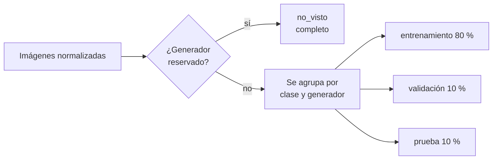

# 4. Los datos

Un modelo es tan bueno como sus datos. Este capítulo explica de dónde salen las imágenes, cómo se controlan y cómo se preparan para que el modelo aprenda lo correcto.

## De dónde sale la información

### Conjuntos públicos (para entrenar)

Se descargan de **Hugging Face**, una plataforma pública de conjuntos de datos y modelos. Se leen en *streaming*: se recorren sin bajar el conjunto entero y se toma una muestra balanceada.

| Conjunto | Qué tiene | Estado |
|---|---|---|
| **Community Forensics (*Small*)** | Fotos reales y generadas por **cientos de generadores** (Stable Diffusion y sus ajustes finos, GAN, DeepFloyd, GLIDE, etc.) | En uso desde la prueba de concepto |
| OpenFake | Imágenes de generadores comerciales recientes | Previsto para la receta v1 (T25 a T27) |
| MS COCOAI | Fotos de COCO y sus versiones generadas | Previsto para la receta v1 |
| ShareGPT-4o-Image | Imágenes generadas con GPT-4o | Previsto para la receta v1 si se verifica la licencia |

**Búsqueda continua de datos (2026-10-30).** La autora decidió seguir buscando conjuntos y generando imágenes para mejorar la red. La investigación con todos los candidatos (OpenFake, Treasure, AIGenImages2026, TrueFake, Semi-Truths y otros), sus licencias y su uso propuesto está en [docs/investigacion/2026-10-30-conjuntos-de-datos-imagenes-sinteticas.md](../investigacion/2026-10-30-conjuntos-de-datos-imagenes-sinteticas.md). Conclusiones clave:
- casi todas las licencias son no comerciales y cambian entre revisiones, así que la receta fija una revisión concreta de cada conjunto;
- no hay conjuntos públicos con fotos pasadas por WhatsApp, por eso el conjunto propio es un aporte original;
- el sesgo de formato documentado en GenImage («Fake or JPEG?») confirma la necesidad de la normalización anti-atajos.

La **licencia** de cada conjunto se verifica y se registra en la ficha (CA2). Un conjunto sin licencia verificable se excluye. Casi todos son **solo para investigación**: alcanza para el proyecto final, pero una versión comercial requeriría reentrenar con datos de licencia compatible.

Las columnas de Community Forensics se confirmaron con su esquema: `image_data` (bytes de la imagen), `label` (1 = sintética), `model_name` (generador), `nsfw_flag` (contenido explícito, que se descarta), `subset`, `real_source` y `architecture`.

### Conjunto propio (para evaluar en condiciones reales)

Lo arma la autora siguiendo el [protocolo del conjunto propio](../guias/protocolo-conjunto-propio.md) (tarea T26): fotos generadas con **ChatGPT, Gemini, Copilot** (y Midjourney si hay acceso), **fotos reales propias** y **fotos reales editadas con IA**, de escenas del ámbito del sistema (daños en vehículos, lesiones, viviendas, documentos, recibos, capturas). Cada una en tres versiones: **original, enviada por WhatsApp y captura de pantalla**.

- **Regla de oro (criterio de la autora, 2026-10-30):** las fotos reales son **de las mismas escenas** que las generadas. Si no, el modelo podría distinguir el tema en lugar de la generación. Las fotos reales salen de CarDD (autos dañados), de fotos propias de la autora como complemento y de conjuntos de lesiones y viviendas que se sigan verificando.
- **Diversidad:** las lesiones se generan en seis tonos de piel para medir si el modelo funciona igual para todas las personas.
- Herramientas gratuitas: ChatGPT, Gemini (suscripción), Copilot, Meta AI, Grok y otras.
- Se guarda en una carpeta **privada** de Google Drive (`evidentia/conjunto-propio/`), con la estructura `<clase>/<generador>/<variante>/`.
- **Nunca** se usa para entrenar ni se sube al repositorio: solo para evaluar (CA12, CA13).
- Se evalúa **sin normalizar**, tal como llega, porque lo que se quiere medir es justamente el efecto de WhatsApp y de las capturas.

### Lo que nunca se usa

Las fotos de los casos de los usuarios. Son confidenciales (RNF08) y no se reutilizan para entrenar.

## El manifiesto: la identidad de un conjunto

Las imágenes no se suben a Git (son muchas, pesadas y tienen licencias). Lo que se versiona es el **manifiesto**: un CSV con una fila por imagen.

| Columna | Ejemplo |
|---|---|
| ruta relativa | ruta de la imagen dentro de la carpeta del conjunto |
| fuente | `community_forensics` |
| clase | 0 (real) o 1 (sintética) |
| generador | `BigGAN`, `Fred99774/girlnew`… |
| variante | `original`, `whatsapp`, `captura`, `editada` |
| partición | `entrenamiento`, `validacion`, `prueba`, `no_visto` |
| huella | SHA-256 de la imagen |

La **huella del manifiesto completo** (SHA-256 de todo su contenido, sin importar el orden de las filas) identifica de forma única una versión del conjunto. Queda en la ficha del modelo y en los metadatos del ONNX: con eso se sabe exactamente con qué datos se entrenó cada modelo (RN29).

## Etapa «obtener»

1. Recorre cada fuente **mezclada con una semilla fija**. Es importante: los conjuntos suelen venir ordenados por generador, y tomar «las primeras N» daría un solo generador.
2. Descarta las filas excluidas por la receta (por ejemplo, contenido explícito).
3. Saltea imágenes repetidas dentro de la fuente (misma huella).
4. Guarda las imágenes **sin modificarlas**, con su formato original, hasta completar las cantidades pedidas por clase.
5. Escribe el **manifiesto crudo**.

La normalización se hace después, para poder auditar qué se descargó exactamente.

## Etapa «validar»

Si alguna verificación falla, **el pipeline se detiene** (CA4). Es mucho más barato descubrir un problema acá que después de horas de GPU. Todas las verificaciones se ejecutan siempre y los errores se informan juntos.

| Verificación | Qué detecta | Por qué importa |
|---|---|---|
| Imágenes | Que cada imagen exista, se pueda abrir y conserve su huella | Una imagen corrupta rompe el entrenamiento |
| Duplicados | La misma imagen dos veces | Infla el peso de algunas imágenes |
| Fugas entre particiones | La misma imagen en entrenamiento y en prueba | El modelo la «recuerda» y las métricas mienten |
| Generadores reservados | Que un generador «no visto» no aparezca en entrenamiento o validación | Si no, ya no es «no visto» |
| Balance | Que reales y sintéticas estén parejas en cada partición (tolerancia del 5 %) | Un desbalance sesga al modelo hacia la clase mayoritaria |

Genera `validacion.json` con los errores y un resumen (conteos por clase, partición, generador y fuente).

## Etapa «preparar»

### Normalización anti-atajos (CA5)

Problema: las fotos reales suelen ser **JPEG de cámara** y las generadas suelen ser **PNG** o de tamaños típicos (512 × 512, 1024 × 1024). Si se dejaran así, el modelo podría aprender un **atajo**: «PNG cuadrado = sintética». Tendría métricas excelentes y fallaría con la primera foto generada que llegue en JPEG por WhatsApp.

Solución: **todas las imágenes, de las dos clases, pasan por el mismo proceso**:

1. Conversión a RGB. La transparencia se compone sobre fondo blanco, igual que en la inferencia.
2. El lado menor se lleva a un valor **al azar entre 256 y 512 px**.
3. Se guardan como **JPEG con calidad al azar entre 75 y 95**.

Así las dos clases quedan con la misma distribución de formato, tamaño y compresión, y lo único que las distingue son las huellas de la generación.

Los valores al azar de cada imagen dependen de la **semilla y de la huella de la imagen**, no del orden en que se procesa. El resultado es idéntico aunque se procese en paralelo o en otro orden (CA7).

### Partición (CA6)

- La partición es **estratificada por clase y generador**: cada grupo (por ejemplo, «sintéticas de BigGAN») se reparte con las mismas proporciones, así todos los generadores aparecen en validación y prueba.
- Usa una **semilla fija** (42): la misma receta da siempre la misma partición.
- Los **generadores reservados** van completos a `no_visto` y nunca se usan para ajustar el modelo.
- Al terminar, se vuelve a validar el conjunto con **todas** las reglas, incluido el balance, y se escribe el manifiesto final `preparado/manifiesto.csv`.

## Dónde queda todo

| Qué | Dónde | Versionado |
|---|---|---|
| Receta (fuentes, cantidades, semilla) | `red_neuronal/configuracion/*.yaml` | Git |
| Imágenes descargadas y preparadas | Disco de Colab durante la corrida | No se guardan (se vuelven a bajar) |
| Manifiestos y resultados | `MyDrive/evidentia/prueba_de_concepto/` (o la carpeta de la versión) | Respaldo en Drive y huella en la ficha |
| Conjunto propio | `MyDrive/evidentia/conjunto-propio/` | Planilla de control con fecha |
