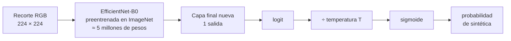
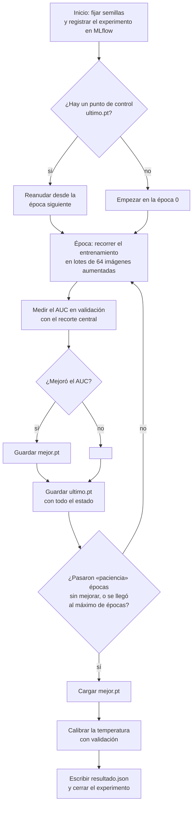

# 5. El entrenamiento

## La red: EfficientNet-B0 con una salida

- La red se crea con **timm**, una biblioteca con cientos de redes preentrenadas que comparten la misma interfaz (`crear_modelo` en `modelo/arquitecturas.py`).
- Se carga con los pesos de **ImageNet** (transferencia de aprendizaje) y se reemplaza la capa final de 1000 categorías por una de **una sola salida**: el logit de la clase «sintética».
- Durante el entrenamiento la red devuelve el **logit**, que es lo que necesita la función de pérdida. La temperatura y la sigmoide se agregan **recién al exportar** (`ModeloExportable`, capítulo 7).
- Arquitecturas admitidas: `efficientnet_b0` (la elegida), `convnext_tiny` y `resnet50`. Cambiar es cambiar una palabra en la configuración.

## Cómo aprende, paso a paso

### Dentro de cada paso (un lote)

1. Se toman 64 imágenes de entrenamiento, cada una con una **aumentación** al azar.
2. La red calcula el logit de cada una.
3. Se mide la **pérdida**: entropía cruzada binaria sobre los logits (`binary_cross_entropy_with_logits`, numéricamente estable).
4. Se calcula cómo cambiar cada peso para bajar la pérdida (retropropagación).
5. El optimizador **AdamW** aplica el cambio, con **decaimiento de pesos** de 0,0001 para que los pesos no crezcan sin control.

### Al final de cada época

1. Se mide el **AUC sobre validación**, usando solo el recorte central (es más rápido; la evaluación final usa cinco recortes).
2. Se baja la tasa de aprendizaje siguiendo una **curva de coseno** que va de 0,0003 a casi 0 a lo largo de las épocas configuradas.
3. Se registran en MLflow la pérdida de entrenamiento y el AUC de validación.
4. Si el AUC mejoró, se guarda `mejor.pt`.
5. Se guarda `ultimo.pt` con **todo el estado**: pesos, optimizador, planificador de la tasa de aprendizaje, escalador de precisión mixta, mejor AUC e historial.

### Parada temprana

Si el AUC de validación no mejora durante `paciencia` épocas seguidas, se detiene. Se queda siempre con la **mejor época**, no con la última. En la prueba de concepto la mejor fue la época 2, contando desde 0: es decir, la tercera y última.

### Puntos de control: retomar si Colab corta

Si la sesión se corta a mitad del entrenamiento, al volver a ejecutar la etapa `entrenar` se carga `ultimo.pt` y se sigue **desde la época siguiente**, sin empezar de cero. La época que estaba en curso cuando se cortó se repite.

### Precisión mixta

Con GPU, los cálculos se hacen en media precisión (16 bits) donde no afecta el resultado. Es casi el doble de rápido en una T4 y usa menos memoria. Un **escalador** evita que los números muy chicos se pierdan. Sin GPU se desactiva sola.

## Las aumentaciones

Cada vez que una imagen de entrenamiento se usa, pasa por transformaciones al azar que **simulan lo que le pasa a una foto antes de llegar al sistema**:

| Paso | Probabilidad | Qué hace | Simula |
|---|---|---|---|
| Reducción | 30 % | Achica la imagen entre el 50 % y el 100 % | Fotos reenviadas, capturas |
| Recompresión JPEG | 50 % | Calidad al azar entre 50 y 95 | WhatsApp y otras apps |
| Recorte al azar | siempre | Un recorte de 224 × 224 de cualquier zona | Que la huella esté en cualquier parte |
| Espejo horizontal | 50 % | Da vuelta la imagen | Variedad sin cambiar el contenido |

Así el modelo aprende huellas que **resisten** la recompresión y el cambio de tamaño (CA12). La validación y la evaluación **no** usan aumentaciones: usan el mismo recorte que la inferencia, para medir lo que de verdad va a pasar en producción.

## Hiperparámetros

Son los valores que se fijan antes de entrenar. Están en el YAML, no en el código (CA8).

| Hiperparámetro | Prueba de concepto | Valor por defecto | Qué controla |
|---|---|---|---|
| `arquitectura` | efficientnet_b0 | efficientnet_b0 | Qué red se usa |
| `preentrenado` | sí | sí | Partir de ImageNet |
| `epocas` | 3 | 10 | Máximo de pasadas por el conjunto |
| `tamanio_lote` | 64 | 64 | Imágenes por paso |
| `tasa_aprendizaje` | 0,0003 | 0,0003 | Tamaño de las correcciones |
| `decaimiento_pesos` | 0,0001 | 0,0001 | Regularización contra el sobreajuste |
| `paciencia` | 2 | 3 | Épocas sin mejorar antes de parar |
| `tamanio_recorte` | 224 | 224 | Lado del recorte de entrada |
| `trabajadores_carga` | 2 | 2 | Procesos que preparan imágenes en paralelo |
| `precision_mixta` | sí | sí | Media precisión en GPU |
| `semilla` | 42 | 42 | Todo lo aleatorio se repite igual |

## Reproducibilidad (CA7)

Con la misma configuración, el mismo manifiesto y la misma semilla, otra corrida debe dar un AUC que difiera en menos de 0,01. Para eso:

- se fijan las semillas de Python, numpy y PyTorch;
- cada proceso de carga recibe una semilla propia y reproducible;
- la normalización depende de la huella de cada imagen, no del orden;
- se registra el **commit** del código. Si había cambios sin confirmar, se marca `-modificado` y la compuerta no deja publicar (capítulo 6).

## Calibración por temperatura

Después de elegir la mejor época:

1. Se calculan los logits de **toda la validación**.
2. Se busca la temperatura `T` que hace más probables las etiquetas reales (minimiza la log-verosimilitud negativa). Se optimiza el logaritmo de `T` para que siempre sea positiva.
3. Se mide el **ECE** antes y después.

| | Prueba de concepto |
|---|---|
| Temperatura | 2,35 |
| ECE antes | 0,047 |
| ECE después | 0,021 |

`T > 1` significa que la red estaba sobreconfiada y la calibración moderó sus probabilidades. El AUC no cambia, porque el orden de las fotos se mantiene.

## Qué deja la etapa

| Archivo | Contenido |
|---|---|
| `entrenamiento/mejor.pt` | Pesos de la mejor época |
| `entrenamiento/ultimo.pt` | Estado completo para reanudar |
| `entrenamiento/resultado.json` | Mejor AUC, mejor época, historial por época, temperatura, ECE, huella del manifiesto e identificador de MLflow |
| `mlruns/` | Experimento de MLflow (parámetros, métricas por época, artefactos) |
