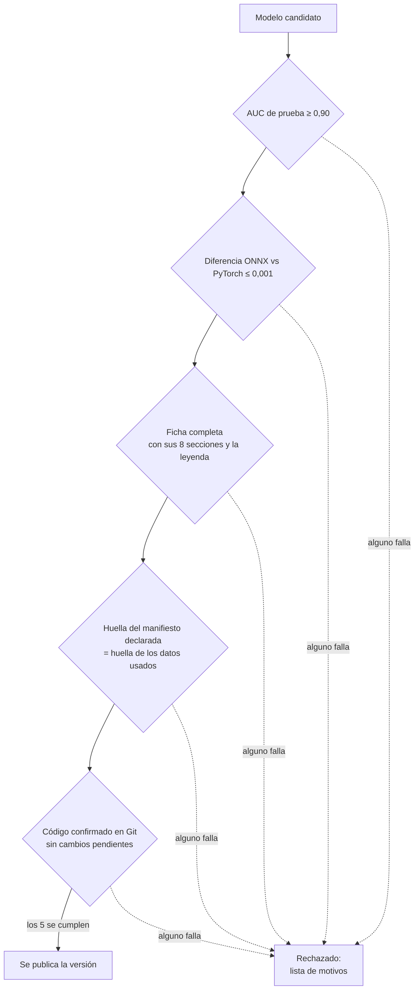

# 6. Evaluación, compuerta y ficha

## La evaluación usa el modelo que se publica

La etapa `evaluar` no usa el modelo de PyTorch: usa el **archivo ONNX exportado**, con el mismo `PredictorOnnx` y el mismo preprocesamiento de cinco recortes que va a usar el backend. Así las métricas que se reportan son las del modelo que realmente llega a producción (CA14).

## Qué se evalúa

| Conjunto | Qué mide | Cuándo |
|---|---|---|
| **prueba** | Desempeño con generadores conocidos (los que se usaron para entrenar, con imágenes que no vio) | Siempre |
| **no_visto** | Desempeño con generadores reservados que nunca vio. Como esa partición solo tiene sintéticas, se comparan contra **las reales de prueba**, que el modelo tampoco vio: así el AUC se puede calcular | Si la receta reserva generadores |
| **condiciones_reales** | El conjunto propio: ChatGPT, Gemini, Copilot, fotos reales, ediciones, en versión original, WhatsApp y captura | Con `--conjunto-propio /ruta` |

## Qué produce

Para cada conjunto, en `evaluacion/<conjunto>/`:

- **`metricas.json`**: las métricas en total, por partición, **por generador** y **por variante**;
- **`predicciones.csv`**: la probabilidad de cada imagen, para analizar los errores uno por uno;
- **`curva_roc.png`**: la curva ROC;
- **`matriz_confusion.png`**: la matriz de confusión.

### La curva ROC

Muestra, para cada umbral posible, cuántas sintéticas detecta el modelo (verdaderos positivos) contra cuántas reales marca por error (falsos positivos). Cuanto más se pega a la esquina superior izquierda, mejor. El **área bajo la curva** (AUC) resume todo en un número: 1 es perfecto y 0,5 es azar.

### La matriz de confusión

Con el umbral de reporte de 0,5, cuenta los cuatro casos:

| | El modelo dice real | El modelo dice sintética |
|---|---|---|
| **Es real** | Verdadero negativo ✔ | Falso positivo ✘ |
| **Es sintética** | Falso negativo ✘ | Verdadero positivo ✔ |

### Por generador

El AUC necesita las dos clases. Para cada generador se comparan **sus** imágenes contra **todas** las reales del conjunto. Responde a: «¿qué tan bien separa el modelo las imágenes de este generador de las fotos reales?».

> **Cuidado al leerla:** con pocas imágenes por generador, la tabla es ruido estadístico. En la prueba de concepto había unas 3 imágenes de cada generador en el conjunto de prueba, y por eso la precisión por generador da valores muy bajos (unos pocos falsos positivos entre 500 reales pesan contra 3 positivos). La receta v1 usa menos generadores con más imágenes cada uno.

### Por escena

En el conjunto propio, el nombre de cada archivo empieza con su escena (`01-choque-007.png`). Las métricas se separan también **por escena**. Como las fotos reales son de las mismas escenas que las generadas (regla de oro), el AUC de cada escena compara reales y sintéticas **del mismo tema**: mide la generación y no el tema. El desglose por tono de piel se arma con la planilla.

### Por variante

En el conjunto propio, las métricas se separan por **original, WhatsApp y captura**. Así se ve cuánto pierde el modelo cuando la foto pasó por una aplicación de mensajería.

## La compuerta de promoción

Un modelo solo se publica si cumple **los cinco criterios** (CA15). La decisión es automática, queda guardada en `compuerta.json` y, si rechaza, informa **todos** los motivos juntos para corregirlos de una vez.

| Criterio | Por qué |
|---|---|
| AUC de prueba ≥ 0,90 (CA10, RNF24 CA3) | El umbral mínimo de calidad acordado |
| Coincidencia ONNX ≤ 0,001 (CA14) | El modelo que corre en el servidor da lo mismo que el entrenado |
| Ficha completa (CA17) | Nadie usa un modelo sin documentación |
| Huella del manifiesto coincide | Los datos declarados son los que se usaron |
| Código confirmado | Un modelo entrenado con cambios sin confirmar no se puede reproducir |

En la prueba de concepto, el umbral de AUC se bajó a 0,51 **solo para esa corrida** (CA1 no exige desempeño) y el modelo se publicó en un registro local, no en Hugging Face.

> **Pendiente de validar con los tutores:** el informe del proyecto pide F1 ≥ 0,85 y la especificación usa AUC ≥ 0,90. Está registrado en los insumos del informe.

## La ficha del modelo (*model card*)

Cada versión publicada tiene una ficha en Markdown que se **genera automáticamente** a partir de las salidas del pipeline, para que no dependa de completarla a mano. Empieza con la leyenda obligatoria:

> Este modelo estima una probabilidad. Su resultado es un indicio y no constituye un dictamen pericial. Consulte a un profesional especializado.

| Sección | Contenido |
|---|---|
| 1. Identificación | Versión, fecha, arquitectura, huella SHA-256 del ONNX, configuración |
| 2. Uso previsto y limitaciones | Qué estima, que no es un veredicto, que no detecta ediciones parciales, generadores no vistos, recompresión, licencias |
| 3. Datos | Huella del manifiesto, semilla, fuentes con licencia, cantidades por partición, generadores reservados, normalización |
| 4. Entrenamiento | Hiperparámetros, mejor época, AUC de validación, temperatura |
| 5. Entorno | Versiones de Python, PyTorch y plataforma, y la GPU usada |
| 6. Métricas | En total, por generador, en no vistos y en condiciones reales |
| 7. Exportación | Diferencia ONNX frente a PyTorch, latencia en CPU, tamaño del recorte |
| 8. Reproducción | Commit del código e identificador del experimento en MLflow |

La ficha se copia a `red_neuronal/informes/<versión>/ficha.md` en Git: es lo único del modelo que vive en el repositorio.
