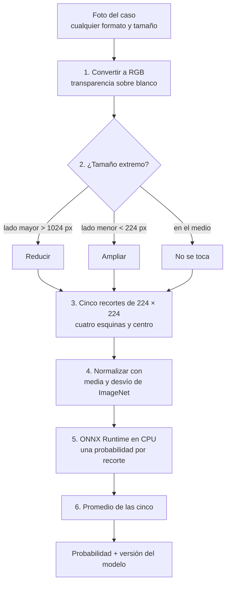

# 7. Exportación, registro e inferencia

## Exportación a ONNX

La etapa `exportar` convierte el mejor modelo de PyTorch en un archivo `modelo.onnx` que corre en CPU:

1. **Envoltorio:** se le agrega al modelo la temperatura y la sigmoide (`ModeloExportable`). Así el archivo devuelve **directamente la probabilidad calibrada**, y nadie tiene que acordarse de calibrar después.
2. **Exportación:** con el exportador moderno de PyTorch (`torch.export`, *opset* 18), con tamaño de lote variable.
3. **Metadatos adentro del archivo:** versión, arquitectura, temperatura, tamaño de recorte, media y desvío de la normalización, huella del manifiesto y commit. Con solo el archivo se sabe qué es y cómo se hizo (RN29).
4. **Un único archivo,** con los pesos incluidos, para que tenga **una sola huella SHA-256**.
5. **Verificación de coincidencia:** se pasan unas imágenes de prueba por PyTorch y por ONNX Runtime y se compara. Si la diferencia máxima supera 0,001, **la exportación falla**. En la prueba de concepto fue de 0,0000026.
6. **Latencia:** se mide cuánto tarda en CPU una imagen con sus cinco recortes. En la prueba de concepto, unos 25 ms.

Deja `exportacion/modelo.onnx` y `exportacion/exportacion.json`.

## Versiones del modelo

Cada modelo publicado tiene una versión `MAJOR.MINOR.PATCH`:

| Cambia | Cuándo | Ejemplo |
|---|---|---|
| **MAJOR** | Cambia el contrato de entrada o salida, o la arquitectura | Pasar a ConvNeXt, cambiar el tamaño del recorte → `2.0.0` |
| **MINOR** | Reentrenamiento con datos nuevos | Sumar un generador comercial nuevo → `1.1.0` |
| **PATCH** | Corrección sin datos nuevos | Recalibrar la temperatura → `1.0.1` |

- `0.x.y` son versiones de prueba. La primera para producción será `1.0.0`.
- Las versiones son **inmutables**: no se puede volver a publicar una versión existente, porque un informe ya emitido debe poder reproducirse con el modelo exacto que lo generó (RN29).

## El registro de modelos

Una versión publicada es un **paquete** (una carpeta) con todo lo necesario para entenderla y reproducirla:

```
v1.0.0/
├── modelo.onnx          El modelo
├── ficha.md             La ficha
├── configuracion.yaml   La configuración usada
├── manifiesto.csv       El manifiesto de los datos
├── entrenamiento.json   Historial, mejor época, temperatura
├── exportacion.json     Coincidencia y latencia
├── evaluacion/          Métricas, predicciones y gráficos
├── mlruns.zip           El experimento de MLflow
└── huellas.json         SHA-256 de cada archivo
```

Al publicar se escribe `huellas.json`. Al **obtener** una versión, se verifica la huella del modelo antes de devolverlo: si el archivo fue alterado, falla.

| Registro | Dónde | Para qué |
|---|---|---|
| `RegistroHuggingFace` | Repositorio **privado** de modelos en Hugging Face Hub (`pfg-clasificador-sintetico`); cada versión es una etiqueta `vX.Y.Z` | Producción. La autora crea el repositorio (tarea E03) |
| `RegistroLocal` | Una carpeta (`<raíz>/v0.1.0/`) | Prueba de concepto y pruebas automáticas |

## Inferencia: cómo se obtiene la probabilidad de una foto

Esto es lo que hace el backend con cada foto de un caso (funcionalidad 012), con `PredictorOnnx`:



### Por qué así

- **No se reescala la foto salvo en los extremos.** Achicarla borraría las huellas finas que deja la generación, que es justamente lo que el modelo mira.
- **Cinco recortes** porque la red ve 224 × 224 y una foto es mucho más grande. Mirar las esquinas y el centro cubre más superficie que un solo recorte, y el promedio estabiliza el resultado.
- **Los parámetros del preprocesamiento se leen del propio ONNX.** Un modelo nunca se ejecuta con un preprocesamiento distinto al suyo.
- **Mismo código en la evaluación y en el backend.** Para la misma imagen dan exactamente la misma probabilidad (hay una prueba automática de contrato que lo verifica).

### El contrato de entrada (ADR-0015)

| Elemento | Valor |
|---|---|
| Entrada del grafo | Tensor `float32` `[N, 3, 224, 224]`, RGB, normalizado con media (0,485; 0,456; 0,406) y desvío (0,229; 0,224; 0,225) |
| Salida del grafo | Tensor `float32` `[N, 1]` con la probabilidad calibrada de cada recorte |
| Agregación | Promedio de los cinco recortes |

Cambiar cualquiera de estos pasos obliga a publicar una versión **MAJOR**.

### Qué necesita el servidor

Solo `numpy`, `Pillow` y `onnxruntime`. Nada de PyTorch ni GPU. En AWS el modelo se descarga del registro en la versión fijada y cada informe guarda qué versión se usó.

## Cómo se ve en el informe (funcionalidad 012)

La capa 4 aparece como una probabilidad con la versión del modelo y la leyenda de que es un indicio. Nunca se combina con las otras capas en un puntaje único (RN27).
