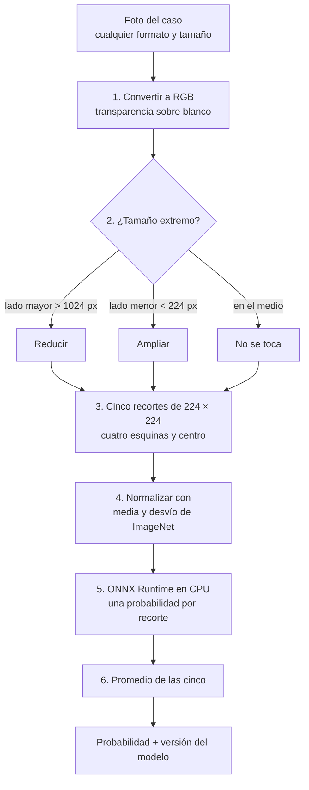
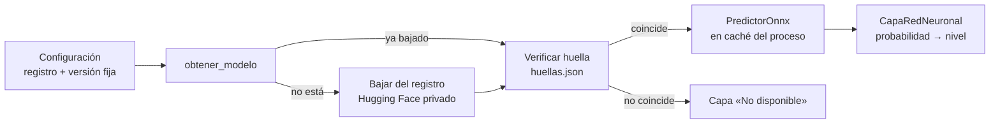

# 7. Exportación, registro e inferencia

## Exportación a ONNX

La etapa `exportar` convierte el mejor modelo de PyTorch en un archivo `modelo.onnx` que corre en CPU:

1. **Envoltorio:** se le agrega al modelo la temperatura y la sigmoide (`ModeloExportable`). Así el archivo devuelve **directamente la probabilidad calibrada**, y nadie tiene que acordarse de calibrar después.
2. **Exportación:** con el exportador moderno de PyTorch (`torch.export`, *opset* 18), con tamaño de lote variable.
3. **Metadatos adentro del archivo:** versión, arquitectura, temperatura, tamaño de recorte, media y desvío de la normalización, huella del manifiesto y commit. Con solo el archivo se sabe qué es y cómo se hizo (RN29).
4. **Un único archivo,** con los pesos incluidos, para que tenga **una sola huella SHA-256**.
5. **Verificación de coincidencia:** se pasan unas imágenes de prueba por PyTorch y por ONNX Runtime y se compara. Si la diferencia máxima supera 0,001, **la exportación falla**. En la prueba de concepto fue de 0,0000026.
6. **Latencia:** se mide cuánto tarda en CPU una imagen con sus cinco recortes. En la prueba de concepto, unos 25 ms.

Deja `exportacion/modelo.onnx` y `exportacion/exportacion.json`.

## Versiones del modelo

Cada modelo publicado tiene una versión `MAJOR.MINOR.PATCH`:

| Cambia | Cuándo | Ejemplo |
|---|---|---|
| **MAJOR** | Cambia el contrato de entrada o salida, o la arquitectura | Pasar a ConvNeXt, cambiar el tamaño del recorte → `2.0.0` |
| **MINOR** | Reentrenamiento con datos nuevos | Sumar un generador comercial nuevo → `1.1.0` |
| **PATCH** | Corrección sin datos nuevos | Recalibrar la temperatura → `1.0.1` |

- `0.x.y` son versiones de prueba. La primera para producción será `1.0.0`.
- Las versiones son **inmutables**: no se puede volver a publicar una versión existente, porque un informe ya emitido debe poder reproducirse con el modelo exacto que lo generó (RN29).

## El registro de modelos

Una versión publicada es un **paquete** (una carpeta) con todo lo necesario para entenderla y reproducirla:

```
v1.0.0/
├── modelo.onnx          El modelo
├── ficha.md             La ficha
├── configuracion.yaml   La configuración usada
├── manifiesto.csv       El manifiesto de los datos
├── entrenamiento.json   Historial, mejor época, temperatura
├── exportacion.json     Coincidencia y latencia
├── evaluacion/          Métricas, predicciones y gráficos
├── mlruns.zip           El experimento de MLflow
└── huellas.json         SHA-256 de cada archivo
```

Al publicar se escribe `huellas.json`. Al **obtener** una versión, se verifica la huella del modelo antes de devolverlo: si el archivo fue alterado, falla.

| Registro | Dónde | Para qué |
|---|---|---|
| `RegistroHuggingFace` | Repositorio **privado** de modelos en Hugging Face Hub (`pfg-clasificador-sintetico`); cada versión es una etiqueta `vX.Y.Z` | Producción. La autora crea el repositorio (tarea E03) |
| `RegistroLocal` | Una carpeta (`<raíz>/v0.1.0/`) | Prueba de concepto y pruebas automáticas |

## Inferencia: cómo se obtiene la probabilidad de una foto

Esto es lo que hace el backend con cada foto de un caso (funcionalidad 012), con `PredictorOnnx`:



### Por qué así

- **No se reescala la foto salvo en los extremos.** Achicarla borraría las huellas finas que deja la generación, que es justamente lo que el modelo mira.
- **Cinco recortes** porque la red ve 224 × 224 y una foto es mucho más grande. Mirar las esquinas y el centro cubre más superficie que un solo recorte, y el promedio estabiliza el resultado.
- **Los parámetros del preprocesamiento se leen del propio ONNX.** Un modelo nunca se ejecuta con un preprocesamiento distinto al suyo.
- **Mismo código en la evaluación y en el backend.** Para la misma imagen dan exactamente la misma probabilidad (hay una prueba automática de contrato que lo verifica).

### El contrato de entrada (ADR-0015)

| Elemento | Valor |
|---|---|
| Entrada del grafo | Tensor `float32` `[N, 3, 224, 224]`, RGB, normalizado con media (0,485; 0,456; 0,406) y desvío (0,229; 0,224; 0,225) |
| Salida del grafo | Tensor `float32` `[N, 1]` con la probabilidad calibrada de cada recorte |
| Agregación | Promedio de los cinco recortes |

Cambiar cualquiera de estos pasos obliga a publicar una versión **MAJOR**.

### Qué necesita el servidor

Solo `numpy`, `Pillow` y `onnxruntime`. Nada de PyTorch ni GPU. En AWS el modelo se descarga del registro en la versión fijada y cada informe guarda qué versión se usó.

## Cómo lo usa el backend: la capa 4 (funcionalidad 012)

El backend no reimplementa nada del modelo: instala el paquete `clasificador` **sin dependencias** (`pip install --no-deps red_neuronal`) y usa `PredictorOnnx`, el mismo código que la evaluación. Así no necesita PyTorch ni GPU, y la probabilidad de una foto es exactamente la de la ficha (ADR-0015). Una prueba automática compara las dos.



| Pieza | Archivo | Qué hace |
|---|---|---|
| Configuración | `backend/app/configuracion/entornos.py` | `MODELO_RED_NEURONAL_REGISTRO` (`hugging_face:<usuario/repositorio>` o `local:<carpeta>`), `MODELO_RED_NEURONAL_VERSION` (versión fija, por ejemplo `1.0.0`) y `CARPETA_MODELOS_ONNX`. Sin valores por defecto: sin configurar, la capa queda «No disponible». `HF_TOKEN` (lectura) solo por el entorno. |
| Obtención del modelo | `backend/app/integraciones/modelo_red_neuronal.py` | Reutiliza el modelo ya bajado si su huella coincide; si no, lo pide al registro. Verifica la huella SHA-256 antes de usarlo y lo deja en una caché por proceso: cada trabajador lo carga una sola vez. Cualquier falla se convierte en un motivo legible. |
| Capa 4 | `backend/app/analisis/red_neuronal.py` | Pasa la foto por el predictor y arma el resultado. |
| Registro de capas | `backend/app/analisis/registro.py` | La agrega después de metadatos, C2PA y ELA, sin tocarlas (ADR-0006). |

### Cómo se lee la probabilidad (ADR-0017)

| Probabilidad calibrada | Nivel de la capa | Lectura |
|---|---|---|
| Menor que 50 % | 0 | La capa no aporta indicios. **No** significa que la foto sea real. |
| De 50 % a 69 % | La probabilidad en porcentaje | Indicios moderados (escala común: desde 45 %) |
| Desde 70 % | La probabilidad, con un máximo de 90 | Indicios fuertes. El 100 se reserva para una declaración de IA con firma C2PA (RN28) |

La conclusión **siempre** aclara que el modelo mira la imagen completa (no detecta ediciones parciales, para eso están las otras capas), que puede fallar con generadores que no vio y, cuando la probabilidad es baja, que eso no indica que la foto sea real. Termina con la recomendación de consultar a un profesional (RN27). Nunca se combina con las otras capas en un puntaje único.

### Qué queda registrado (RN29)

Cada resultado guarda la probabilidad, la versión del modelo, la huella SHA-256 del ONNX, la huella del manifiesto de entrenamiento, el commit con que se entrenó y la versión de ONNX Runtime. La tabla de criterios que ven el usuario y el informe PDF muestra la probabilidad, el umbral, la escala, la versión del modelo y el desempeño publicado de esa versión (AUC 0,961 con generadores conocidos y 0,938 con la familia de Google, que no vio).

### Pruebas sin red

Las pruebas del backend usan un **ONNX diminuto** (`backend/pruebas/modelo_diminuto.py`) con la misma entrada, la misma salida y los mismos metadatos que el real, pero que calcula una sigmoide del brillo medio. Así se prueban la carga, la caché, la verificación de huellas y la capa sin PyTorch, sin Hugging Face y en milisegundos.

### En producción

`generar_entorno.sh` copia del Parameter Store `MODELO_RED_NEURONAL_REGISTRO`, `MODELO_RED_NEURONAL_VERSION` y `HF_TOKEN`, y fija `CARPETA_MODELOS_ONNX=/opt/plataforma/modelos_onnx`, fuera de cada versión desplegada, para no volver a bajar el modelo en cada despliegue. La guía para activarlo está en [despliegue-aws.md](../guias/despliegue-aws.md#capa-4-modelo-de-la-red-neuronal-funcionalidad-012).

### Cómo se suma al resto del sistema (037)

Desde la 037 cada capa se describe sola: `CapaRedNeuronal` declara `titulo`, `que_significa` y `tipo_de_resultado = "probabilistico"`, y está en `crear_capas()` y en `CLASES_DE_CAPAS` (`backend/app/analisis/registro.py`). La pantalla del análisis toma el título y la explicación de la API; la prueba `test_analisis_registro.py` falla si una capa activa no los tiene.

Queda un paso para cuando la capa funcione en producción (T08): quitar `proximamente: true` de la mirada «Imagen con IA» en `frontend/src/paginas/PaginaPortada.jsx` y la frase «se suma próximamente» de los términos. No se quita antes para no anunciar una capa que todavía aparece como «No disponible».
