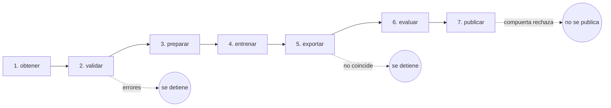
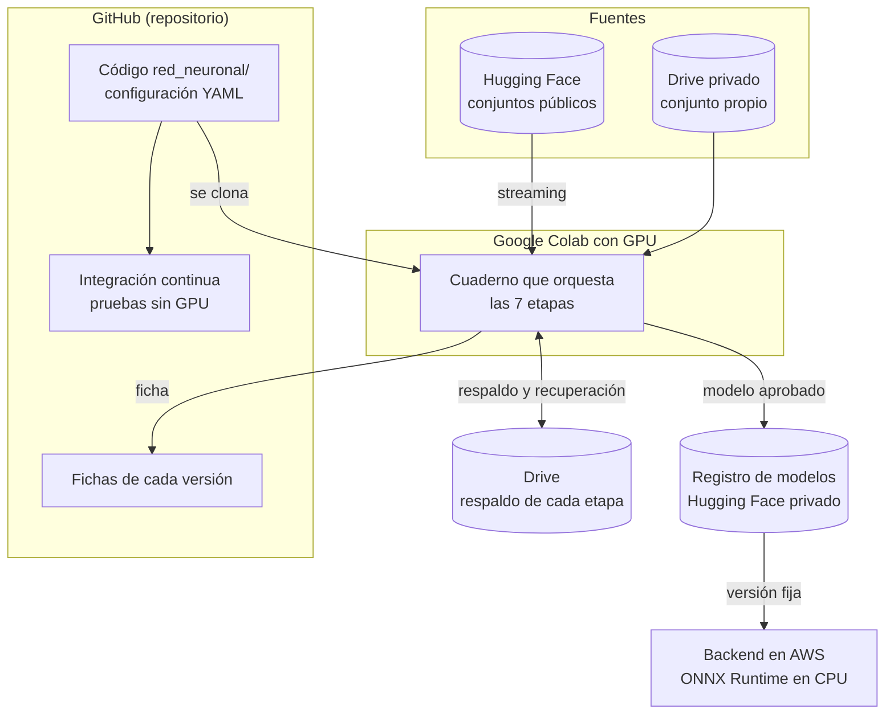
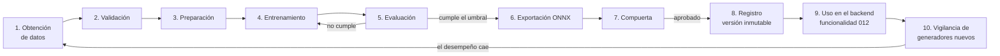

# 8. Pipeline y ciclo de vida

## El pipeline: siete etapas

Cada etapa es un comando independiente que **lee lo que dejó la anterior en disco y escribe lo suyo** en una carpeta fija. Así una etapa se puede repetir o retomar sin rehacer las demás, por ejemplo si Colab corta la sesión.



| # | Etapa | Entra | Sale | Se detiene si |
|---|---|---|---|---|
| 1 | **obtener** | Configuración de fuentes y cantidades | Imágenes originales + `manifiesto_crudo.csv` | Una fuente no está disponible o no alcanza la cantidad pedida |
| 2 | **validar** | Manifiesto crudo | `validacion.json` | Imágenes corruptas, duplicadas o fugas entre particiones |
| 3 | **preparar** | Manifiesto crudo | Imágenes normalizadas + `preparado/manifiesto.csv` | La revalidación encuentra errores o desbalance |
| 4 | **entrenar** | Manifiesto preparado | `mejor.pt`, `ultimo.pt`, `resultado.json`, experimento en MLflow | — (se reanuda si se cortó) |
| 5 | **exportar** | `mejor.pt` y temperatura | `modelo.onnx`, `exportacion.json` | ONNX y PyTorch difieren más de 0,001 |
| 6 | **evaluar** | `modelo.onnx` y manifiesto (y el conjunto propio) | `evaluacion/<conjunto>/` con métricas, predicciones y gráficos | — |
| 7 | **publicar** | Todo lo anterior | Ficha, `compuerta.json` y versión publicada | La compuerta rechaza |

### La carpeta de trabajo

```
trabajo/
├── crudo/, manifiesto_crudo.csv, validacion.json   obtener y validar
├── preparado/  manifiesto.csv                      preparar
├── entrenamiento/  mejor.pt  ultimo.pt  resultado.json   entrenar
├── mlruns/                                         entrenar (MLflow)
├── exportacion/  modelo.onnx  exportacion.json     exportar
├── evaluacion/  prueba/  no_visto/  condiciones_reales/   evaluar
├── compuerta.json                                  publicar
└── paquete/                                        publicar
```

## Dónde ocurre cada cosa



## El ciclo de vida completo del modelo

Construir el modelo no es un evento único: es un ciclo que se repite cuando cambia el mundo (aparecen generadores nuevos).



### Las fases del proyecto

| Fase | Qué se hace | Estado |
|---|---|---|
| **Prueba de concepto** (CA1) | Recorrer todo el ciclo con 10 000 imágenes para validar el diseño y medir tiempos | ✔ Hecha el 2026-10-30 (capítulo 11) |
| **Datos reales** (T25 a T28) | Explorar las fuentes, armar el conjunto propio y la receta v1 con generadores no vistos | Próximo |
| **Entrenamiento completo** (T29 a T31) | Entrenar con la receta v1, iterar hasta AUC ≥ 0,90 y verificar la reproducibilidad | Pendiente |
| **Condiciones reales** (T32) | Evaluar con el conjunto propio por herramienta y por variante | Pendiente |
| **Publicación** (T33) | Publicar `1.0.0` en Hugging Face a través de la compuerta y copiar la ficha | Pendiente |
| **Demostración de reentrenamiento** | Reservar un generador comercial (por ejemplo, Gemini) como no visto en la 1.0.0, medir cuánto le cuesta, sumarlo a los datos y publicar la 1.1.0 mostrando la mejora | Planificado (decisión del 2026-10-30) |
| **Integración** (012) | El backend usa el modelo y el informe muestra la capa 4 | Pendiente |
| **Mantenimiento** (CA18) | Vigilar generadores nuevos y reentrenar | Continuo |

### Cuándo se reentrena (CA18)

- **Disparador:** aparece un generador comercial nuevo (por ejemplo, una versión nueva de la herramienta de imágenes de ChatGPT o de Gemini) y su desempeño en el conjunto propio cae de forma significativa.
- **Cómo:** se suman imágenes del generador nuevo a la receta (nueva versión de datos), se entrena, se evalúa y se publica una versión **MINOR** nueva.
- **Sin romper lo anterior:** las versiones viejas siguen en el registro. Los informes ya emitidos dicen con qué versión se hicieron y se pueden reproducir con ese modelo exacto.
- **No se reentrena con datos de usuarios:** son confidenciales (RNF08).
