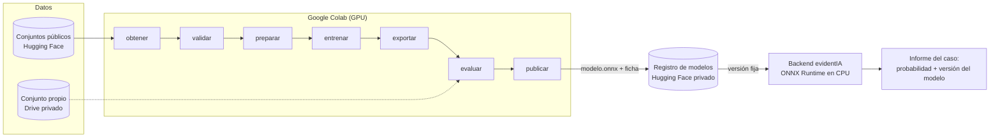

# La red neuronal de evidentIA

Documentación completa del clasificador de imágenes sintéticas (capa 4 del análisis), de punta a punta: qué es, cómo está hecho, de dónde salen los datos, cómo se entrena, cómo se evalúa, cómo se publica, cómo lo usa el sistema y cómo se mantiene en el tiempo.

Está escrita para leerse en orden por alguien que no conoce el proyecto, pero cada capítulo se puede consultar por separado. Las palabras técnicas se explican la primera vez que aparecen y están todas en el [glosario](glosario.md).

> **Regla de oro (RN27):** la red neuronal estima una **probabilidad**. Su resultado es un indicio técnico y nunca un veredicto. La decisión siempre la toma una persona, con ayuda de un profesional.

## En una página

1. **Qué hace:** mira una foto y estima la probabilidad de que haya sido **generada íntegramente con IA**.
2. **Cómo aprende:** se parte de una red ya entrenada para reconocer objetos (EfficientNet-B0, entrenada con ImageNet) y se la reentrena con miles de fotos reales y sintéticas. Esto se llama **transferencia de aprendizaje**.
3. **Dónde se entrena:** en Google Colab, con GPU. La autora tiene Colab Pro por un año.
4. **Qué se entrega:** un archivo `modelo.onnx` que corre en cualquier computadora sin GPU, más una **ficha** que explica con qué datos y código se hizo y qué tan bien funciona.
5. **Cómo se controla la calidad:** antes de publicar un modelo, una **compuerta** automática verifica que cumpla los criterios; si no, no se publica.
6. **Cómo lo usa el sistema:** el backend descarga una versión concreta, la ejecuta en el servidor y guarda en cada informe qué versión se usó (RN29).

## Capítulos

| # | Capítulo | Qué vas a encontrar |
|---|---|---|
| 1 | [Qué es y para qué sirve](01-que-es-y-para-que-sirve.md) | El problema, el rol en las cuatro capas, qué detecta y qué no |
| 2 | [Conceptos básicos](02-conceptos-basicos.md) | Red neuronal, convolución, transferencia de aprendizaje, épocas, lotes, pérdida, AUC, calibración, explicados sin matemática |
| 3 | [Arquitectura y organización del código](03-arquitectura-y-codigo.md) | Carpetas, módulos, patrones de diseño, dependencias y cómo encaja todo |
| 4 | [Los datos](04-datos.md) | De dónde salen las imágenes, el manifiesto, la validación, la normalización anti-atajos y las particiones |
| 5 | [El entrenamiento](05-entrenamiento.md) | EfficientNet-B0, cómo aprende paso a paso, épocas, parada temprana, puntos de control, aumentaciones y calibración |
| 6 | [Evaluación, compuerta y ficha](06-evaluacion-compuerta-y-ficha.md) | Métricas, curva ROC, matriz de confusión, evaluación por generador y en condiciones reales, criterios de publicación |
| 7 | [Exportación, registro e inferencia](07-exportacion-registro-e-inferencia.md) | ONNX, versiones, registro de modelos y cómo el backend obtiene la probabilidad de una foto |
| 8 | [Pipeline y ciclo de vida](08-pipeline-y-ciclo-de-vida.md) | Las siete etapas en detalle, qué entra y qué sale de cada una, y el ciclo completo del modelo |
| 9 | [MLOps: CI, CT y CD](09-mlops-ci-ct-cd.md) | Integración continua, entrenamiento continuo, entrega continua, seguimiento de experimentos y nivel de madurez |
| 10 | [Entrenar en Colab paso a paso](10-colab-paso-a-paso.md) | Qué preparar, cómo correr el cuaderno, qué hacer si se corta y problemas frecuentes |
| 11 | [Prueba de concepto y resultados](11-prueba-de-concepto-y-resultados.md) | Qué se midió, cómo leerlo y qué se aprendió |
| 12 | [Estado, decisiones y próximos pasos](12-estado-decisiones-y-proximos-pasos.md) | Dónde está hoy, por qué se eligió cada cosa, riesgos y lo que falta |
| — | [Glosario](glosario.md) | Todos los términos, en orden alfabético |

## Documentos relacionados

- Especificación de la funcionalidad: [docs/funcionalidades/010-red-neuronal/especificacion.md](../funcionalidades/010-red-neuronal/especificacion.md)
- Plan técnico y tareas: [plan.md](../funcionalidades/010-red-neuronal/plan.md), [tareas.md](../funcionalidades/010-red-neuronal/tareas.md)
- Decisiones de arquitectura: [ADR-0014](../arquitectura/decisiones/0014-ciclo-de-vida-y-mlops-del-clasificador.md) (ciclo de vida y MLOps) y [ADR-0015](../arquitectura/decisiones/0015-arquitectura-y-contrato-de-inferencia-del-clasificador.md) (arquitectura y contrato de inferencia)
- Código: [red_neuronal/](../../red_neuronal/)

## Cómo se mantiene esta documentación

Todo cambio en la red neuronal (código, configuración, datos, entrenamiento, resultados o decisiones) actualiza el capítulo que corresponde **en el mismo cambio**. Los resultados de cada corrida de entrenamiento se agregan al capítulo 11 y a la bitácora. Pedido de la autora, 2026-10-30.
